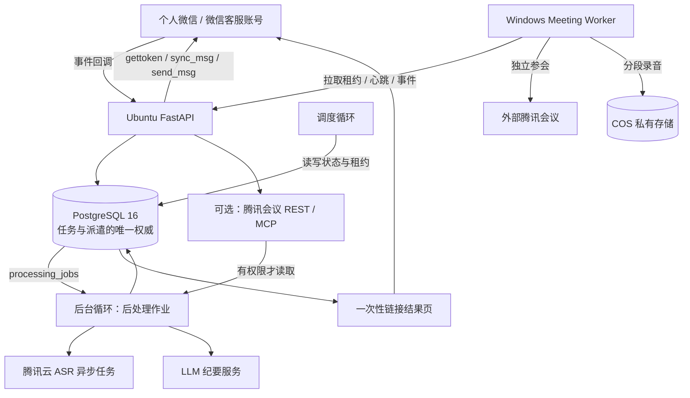

# AI 会议助手｜全链路开发方案 V1.1

**版本**：V1.1 技术方案 / 待验证架构（V1.0 存档于 [`archive/v1.0/`](./archive/v1.0/)，变更依据见 [`评审问题与修改方案_V1.0.md`](./评审问题与修改方案_V1.0.md)）
**日期**：2026-10-09
**目标**：普通微信用户提交外部腾讯会议邀请 → 会议助手尝试独立入会，在获得相应许可后录音 → 语音转写 → LLM 总结 → 通过微信或安全网页交付。
**约束**：
- 第一版只支持腾讯会议；
- 本地开发主环境为 Windows 11 + WSL Ubuntu；
- 不使用 CloudBase；
- 企业微信已完成企业认证（2026-10-09 确认）；
- 不能假设具有外部会议的创建者或主持人权限。

> **结论和阻断点**
>
> 1. **技术阻断点**：腾讯会议 REST API 和 MCP 能读取**有权限**的会议、已有的云录制、转写和纪要，但没有公开的一步式能力去“加入任意外部会议并提供音频流”。独立参会加录音的 Worker 是核心的待验证依赖。[T1][T2][T3][T4]
> 2. **合规阻断点**：用 GUI 自动化操控腾讯会议客户端，可能落入《腾讯会议软件许可及服务协议》7.3.2 关于第三方工具的禁止条款，违反时可被封号。[T18]
>
> 在取得**腾讯书面许可或法务结论（G1a）**并通过**技术 PoC（G1b）**之前，不应宣称自动代理参会已经完成。在此之前，可以先交付不依赖参会的**保底 MVP**：用户提供录音或官方纪要，系统生成结构化纪要。

## 1. MVP 需求与验收

### 用户故事

1. 微信用户进入「AI会议助手」微信客服会话，发送一条腾讯会议链接、会议号和密码，以及开会时间。
2. 后端解析出必要字段，缺少时间、密码或称呼时向用户询问。
3. 字段收齐后，发送带版本号的授权说明，用户回复“同意”后才排期（会前同意，见 §8.2）。
4. 到点后把任务分配给可用的参会 Worker。Worker 以“AI会议记录助手（代某某记录）”的身份申请入会，默认关闭麦克风和摄像头，遵守主持人的准入和录制规则。
5. 入会后公开告知录音用途，**主持人授权后才录音**（会中许可，见 §8.2）。录音分段落盘并上传；入会失败、被拒、超时都有明确提示。
6. 会议进行中，用户可以选择“结束并出纪要”或“取消并删除”。
7. 会议结束后，ASR 生成带时间戳的逐字稿，LLM 输出摘要、决策和待办。用户通过微信消息中的一次性链接查看结果。
8. **保底 MVP**：用户也可以直接发来录音文件或腾讯会议生成的纪要文本，系统生成结构化纪要。这条路径不需要 Worker 参会。

### 严格边界

- 机器人不代表用户发言，不代替本人投票，也不操控主持人。
- **外部会议**指可以由别人创建的会议。**不保证**能进入加密、锁定、仅限特定成员或被主持人拒绝的会议。
- **用户发来会议号不等于取得了录音同意。** 委托人需要确认自己有权委托；机器人在会中以可识别的身份出现，并按会议和参会者适用的规则告知、取得许可。没有许可不得开始录制。
- 显示名由服务端按模板生成，固定以“AI会议记录助手”开头（schema 中有 CHECK 约束），不接受用户自定义整串名称。
- V1 每个 Worker 同一时间只参加一个会议；人工测试期只使用经过授权的测试会议。

### 功能分层

| 层级 | V1 必须 | 条件成立才做 / 未来再做 |
|---|---|---|
| 消息入口 | 微信客服收发消息、任务确认 | 其他聊天平台 |
| 会议任务 | 解析、持久化、调度、结束或取消、失败反馈 | 日历同步、多人共享 |
| 参会 | 外部会议入会、状态识别、录音许可、音频采集（**以 G1a 和 G1b 通过为前提**） | SDK 商业多实例、实时字幕互动 |
| 后处理 | 录音 → ASR → 纪要；**保底 MVP：用户上传的录音或转发的官方纪要 → 纪要** | 有权限时复用官方逐字稿或智能纪要 |
| 官方集成 | 可配置的 REST API / MCP Adapter | 腾讯会议 OAuth 多账号授权的商业化 |
| 交付 | 微信消息和一次性链接结果页 | 不受限制的主动微信通知（接口有限制） |

## 2. 当前官方能力评估（文档确认 ≠ 实测）

| 能力 | 官方方式 | 能否覆盖“陌生外部会议” | V1 用法 | 证据 |
|---|---|---|---|---|
| 会议查询 | REST `GET /v1/meetings/{meetingId}`、按 `meeting_code` 查询；MCP `get_meeting_by_code` | **不能保证**。REST 和 MCP 都受调用账号及授权范围限制 | 辅助校验；查询失败不能证明会议不存在 | [T1][T2] |
| 查已有云录制 | REST 录制列表、文件地址；MCP `get_records_list`、`get_record_addresses` | 需要录制访问权限；这不是录音指令 | 可选信息源 | [T1][T5] |
| 查转写和智能纪要 | REST `/v1/records/transcripts/details`、`/v1/smart/minutes/{record_file_id}`；MCP 相应工具 | 受权限、账号版本和生成状态限制 | 获得授权时复用 | [T1][T6][T7] |
| 实时转写推送 | `POST /v1/asr/push-status` 加 `meeting.asr-push` Webhook | **不能**凭任意外部会议号开启：只有会议创建者能开启推送 | 未来授权会议的优化路径 | [T8][T9] |
| 开启实时转写 | `PUT /v1/real-control/meetings/{meeting_id}/asr` | 要求会议进行中，且操作者为主持人 | V1 不把它作为外部会议的依赖 | [T10] |
| 程序化入会 | 腾讯会议客户端 SDK `joinMeetingByJSON` 等 | **技术上可以发起**，但 SDK 只支持企业版，授权范围和录音能力待 PoC | 优先申请官方 SDK | [T3] |
| 自动原始音频采集 | 公开 REST/MCP 中没有这项能力；SDK 的原始音频接口未确认 | 不能直接承诺 | Windows Worker 录音 PoC，同时咨询 SDK | [T1][T3] |
| 客户端本地录制 | 主持人授予成员本地录制权限后，成员可以录制，全员可见录制状态 | 取决于主持人是否授权 | **会中录音许可的首选方式**（§8.2） | [T19][T20] |
| 腾讯会议 MCP | 云端 Server 加本地 Python Skill 代理，共 18 个工具 | Token 与账号绑定，不能越过资源权限 | 开发期做功能探测；生产环境不依赖 | [T2] |

**2026 年安全变更（STS-Token）**

适用范围：
- 新建的腾讯会议**自建 OpenAPI 应用**，自 2026-01-16 起调用单个录制详情、自 2026-02-10 起调用录制转写详情，都必须携带 STS-Token；
- 第三方 OAuth 应用不需要。

获取方式：
- 调用 `POST /v1/app/sts-token`，接口只返回 `req_id`，票据通过 Webhook 下发；
- 前提：在企业管理后台配置回调域名，并订阅“STS Token 生成”事件；operator 必须是超级管理员或管理员；应用需要“管理企业资源”权限；
- `valid_time` 只能取 6、12 或 24 小时，需要定时刷新。票据存入 `tmeeting_credentials`。

这只影响 G4 的路径 B。[T5][T6][T11]

### MCP 的确切定位

腾讯会议官方公开的 18 个工具：
- 会议管理：`schedule_meeting`、`update_meeting`、`cancel_meeting`、`get_meeting`、`get_meeting_by_code`。
- 人员信息：`get_meeting_participants`、`get_meeting_invitees`、`get_waiting_room`、`get_user_meetings`、`get_user_ended_meetings`。
- 录制与文字：`get_records_list`、`get_record_addresses`、`get_transcripts_paragraphs`、`get_transcripts_details`、`search_transcripts`、`get_smart_minutes`。
- 辅助：`convert_timestamp`、`check_skill_version`。[T2]

官方没有列出 `join_meeting` 或 `start_recording`。

**个人 MCP Token 绝对不能当成所有微信客户共享的腾讯会议授权**，也不应向用户索要 Token 放进聊天记录。目前官方 Skill 的企业账号接入仍需申请，处于灰度阶段。[T2]

## 3. 与企业微信自建应用的适配关系

### 对普通微信用户，实际入口是「微信客服」

- 普通个人微信用户不是公司企业微信的内部成员，不能像私聊机器人那样直接给自建应用发消息。
- 需要在企业微信管理后台开通「微信客服」，创建「AI 会议助手」客服账号，并指定由 API 管理的客服账号和授权应用。
- **现有的企业微信自建应用是 FastAPI 与微信客服之间的桥梁**：在「微信客服应用 → API」中，把它选为“可调用接口的应用”（官方原文：“在‘可调用接口的应用’中选择自建应用，配置后该应用才可以调用微信客服的接口”）。它本身不是面向个人微信用户的聊天窗口，用户始终在微信客服会话里与我们交互。
  - **凭证**：用 `corpid` 加**该自建应用的 Secret** 调 `gettoken`，换到的 access_token 用于调用 `kf/*` 接口。官方概述页没有逐字写明这一点，首次联调时需要确认。
  - **回调**：微信客服的 `kf_msg_or_event` 事件发到**该自建应用**“接收消息”中配置的 URL；Token 和 EncodingAESKey 也是这个应用的。
  - **两个硬性要求**：客服账号要设为“通过 API 管理微信客服账号 - 企业内部开发”，此后“官方原生设置的接待规则将暂不生效”，收发和会话分配都由我们的程序负责；接待人员必须在自建应用的可见范围内，否则返回 `60030`。[W1]
- 自建应用 Secret 和腾讯会议 OpenAPI 凭据是**相互独立的密钥**，不能混用。[W1][W2][W3]

**会话状态与人工接管**

`kf/service_state/get` 和 `trans` 定义了五种会话状态：

| 状态 | 含义 | 能否调用 `send_msg` |
|---|---|---|
| 0 | 未处理 | 能 |
| 1 | 由智能助手接待 | 能 |
| 2 | 待接入池排队中 | 不能 |
| 3 | 由人工接待 | 不能 |
| 4 | 已结束/未开始 | 不能 |

处理规则：
- 机器人收到消息后，把会话转为状态 1。
- 只有在用户要求或出现异常时，才转入 2 或 3 交给人工。
- 会话处于 2 或 3 期间，outbox 中待发的消息改为 `DEFERRED`，并提醒人工客服跟进。[W6][W3]

### 实际的微信收发链路

```text
普通微信用户 --发邀请--> 微信客服账号(open_kfid)
                            |
                            v
             POST /webhooks/wecom/kf  (签名校验 + AES 解密)
                            |
                            v
        收到事件 kf_msg_or_event (事件中有 Token、OpenKfId)
                            |
                            v
             POST qyapi.weixin.qq.com/cgi-bin/kf/sync_msg
                            |
                     消息、msgid、external_userid
                            |
                消息去重 → 解析 → 创建/更新任务
                            |
             POST qyapi.weixin.qq.com/cgi-bin/kf/send_msg
                            |
                     微信客服给用户回复
```

回调通常**不包含用户消息正文**，只是通知后端去调用 `kf/sync_msg` 拉取。拉取规则：
- **尽快用回调里的 Token 拉取**：该 Token 10 分钟内有效；不带 Token 也能调用，但频率限制很严。
- 拉取期间对 `kf_sync_state` 行执行 `SELECT … FOR UPDATE`；`next_cursor` 与 `kf_inbox` 的写入在同一事务中提交。
- 只看 `has_more` 决定是否继续拉，**不能因为 `msg_list` 为空就停止**。
- 按 `(open_kfid, msgid)` 去重。
- `sync_msg` 只能读取最近 3 天的消息：另设一个低频对账任务补拉漏掉的消息，同时不能长时间停机后才回补。`sync_msg` 也读不到我方通过 `send_msg` 发出的消息。[W4]

**回复窗口**：用户主动发消息后的 48 小时内，最多可以回复 5 条，并且受会话状态约束。官方没有明确说用户每发一条新消息，窗口和条数是否重新计算。实现上按“从最近一条用户消息起算”处理，再用 `msg_send_fail` 事件中的 `fail_type` 兜底（4 表示超过 48 小时，6 表示超过 5 条），并在 G5 实测确认。消息预算见 §5.4。[W3][W4]

**首条消息**：用户通过客服链接进入、还没发消息时，会话处于状态 4，不能调用 `send_msg`。此时只能用 `enter_session` 事件中的 `welcome_code` 发欢迎语：
- 限 1 条，20 秒内有效，只能用一次；
- 必须在回调处理中立即发送，不能放进慢队列；
- 授权说明等用户发出第一条消息后再发。[W4][W7]

**回调时限**：企业微信的 GET URL 校验要在 **1 秒内**返回解密后的明文，不能带引号、BOM 或换行。POST 回调 5 秒超时，失败后最多重试 3 次。所以回调处理只做验签、解密、把 Token 加密后写入 `kf_sync_state.pending_sync_token_ciphertext`（同时记录 10 分钟后的过期时间），并触发拉取。拉取成功后清空这个 Token。[W2]

**回调的可靠性**：官方明确说“目前无法保证 100% 回调成功”，并“建议开发者不要强依赖回调，需要额外机制对齐相关业务数据”。所以上面那个低频对账任务是**必需的**，不是可选项。[W10]

### 部署约束（自建应用，官方原文已核实）

| 约束 | 官方要求 | 对我们的影响 |
|---|---|---|
| **企业可信 IP** | 2022-06-20 之后新建的自建应用“必须在管理端配置可信 IP，仅配置的可信 IP 能调用接口”；只能填公网 IPv4，不支持 IP 段和 IPv6，每个应用最多 120 个，配置后约 1 分钟生效；未配置时报 `60020` | 所有调用企业微信接口的机器都要有**固定的公网 IPv4**。家用宽带出口 IP 会变化，本地 WSL 直连基本不可行，开发期也需要一台云服务器 |
| **回调 URL** | “接收消息服务器配置的 URL 不支持写 ip 地址”；支持 http 和 https，建议用 https | 必须使用域名，并配置 HTTPS 证书 |
| **域名主体** | “变更域名配置时，域名的备案主体需要与企业认证主体相同或具有关联关系” | 使用**公司主体已备案的域名**；内网穿透工具生成的临时域名不可用 |
| **可信域名**（用到网页授权或应用内网页时） | 需要 ICP 备案且在工信部可查，不支持 IP、泛域名和内网域名 | 结果页域名建议同样使用已备案的公司域名 |

[W8][W9][W11]

**开发方式**：业务代码在本地开发和测试（微信客服接口用 mock）；涉及企业微信接口的联调，在已加入可信 IP 的云服务器上运行。

### 企业微信后台配置顺序

1. 开通微信客服，创建客服账号，取得 `open_kfid`；在「微信客服应用 → API」中开启 API，选择自建应用；把客服账号设为“通过 API 管理”；确认接待人员在该应用的可见范围内。
2. 准备好云服务器（固定公网 IPv4）和公司主体已备案的域名，部署 FastAPI，回调地址为 `https://api.example.com/webhooks/wecom/kf`。
3. 在自建应用的“企业可信 IP”中加入服务器的出口 IP。
4. 在自建应用的“接收消息 → 设置 API 接收”中填写回调 URL、Token 和 EncodingAESKey，完成 GET URL 校验。POST 回调同样必须验签、解密。
5. 用 `corpid` 加自建应用的 Secret 调用 `/cgi-bin/gettoken`，获取并缓存 access_token。
6. 用个人微信打开客服链接测试：在控制台观察回调、`sync_msg` 和 `send_msg`，确认对方是真实的普通微信用户，而不是企业内部成员。

## 4. 端到端系统设计



**职责划分**

| 组件 | 负责 | 不负责 |
|---|---|---|
| PostgreSQL | **任务状态与派遣的唯一权威**：任务、租约、attempt、outbox、后处理作业 | — |
| 调度循环（单进程，周期约 5 秒） | 把到点的 SCHEDULED 改为 DISPATCHING；派遣超时处理；回收过期租约；把 RETRY_WAIT 改回 DISPATCHING；检测卡住的任务 | 不直接联系 Worker |
| Windows Worker | 主动领取租约；入会、取得许可、录音、上传 | 不直接改任务状态，只上报事件 |
| 后台循环（`app.runner`，与调度循环同进程） | 后处理作业（音频合并、ASR 提交与轮询、LLM 纪要）、`task_effects` 和消息发送：从 PG 用 `FOR UPDATE SKIP LOCKED` 领取到期的行，每一步都可以重复执行 | **不承担会议派遣** |

V1 不引入 Redis 队列：作业状态全部在 PG 中，进程重启后从表里继续，不会丢作业。量大到单进程跟不上时，再把 `run_jobs` 拆到独立进程（领取逻辑本身已支持并发）。COS 存放私有音频；ASR 和 LLM 不与会议客户端耦合。

### 路线选择器（避免把官方 API 用错）

1. **主路径 A：独立参会**。外部会议没有云录制权限时：Worker 参会录音 → COS → ASR → LLM。**以 G1a 和 G1b 通过为前提。**
2. **条件路径 B：官方现有数据**。在授权范围内确实能取到逐字稿或录制时，通过 REST（可选 MCP）读取 → LLM；不得跨权限读取。
3. **条件路径 C：企业受控会议的实时转写**。会议创建者和主持人满足条件时，开启官方实时转写和推送 → Webhook → LLM。**它不是 A 的替代品。**[T8][T10]
4. **保底路径 D：用户提供材料**。用户上传录音（`task_kind=USER_UPLOAD`）或转发官方纪要文本（`FORWARDED_MINUTES`）→ ASR 或直接生成纪要。与 A 共用全部后处理代码，不需要 Worker。

**保底路径 D 的入口**（官方限制见 §7.1：微信客服只能收到 20MB 以内的文件、10MB 以内的视频，消息里只有 `media_id`，没有文件名、大小和类型）：

| 用户做了什么 | 系统怎么处理 |
|---|---|
| 在微信里发录音文件或视频（不超过上限） | 先用 Range 只取文件头 4KB 判断类型（`intake/material.py`），是音视频就建 `USER_UPLOAD` 任务并请用户确认上传声明；回复“同意”后由 `AUDIO_NORMALIZE` 作业下载、用 ffprobe 校验、ffmpeg 转成 16k 单声道 m4a（转码后再按实际时长复核），再进入 ASR。用户连发几个文件后回复一次“同意”，所有待确认的材料一起开始处理，各自记录同意 |
| 发导出的逐字稿或纪要文件（txt / Word，含 UTF-16 文本） | 下载全文（不超过 20MB）提取文字，建 `FORWARDED_MINUTES` 任务；PDF、旧版 .doc 暂不支持，提示导出 txt 或 .docx。解析在线程里执行并有超时，XML 元素数和字数都有上限，损坏的文件直接回复“无法识别” |
| 粘贴纪要或逐字稿文字（200 字以上） | 建 `FORWARDED_MINUTES` 任务；30 分钟内的后续消息（无论长短）都按续篇追加，回复“发完了”只确认收齐；“同意”后解析成分段逐字稿（兼容“发言人 00:01:23”、“[00:01] 张三：…”等排版，其余按行），直接生成纪要。超过约 9 万字（一次纪要请求放不下）在收到时就回复“内容太长”，不等同意之后才失败 |
| 录音超过上限（微信会改发一条文字提示），或回复“上传录音” | 回复一次性上传链接（发送时现签，24 小时有效、只能上传一次；任务已结束的延迟消息不再发出）；网页上勾选声明后上传：链接、任务状态和声明版本在读取文件之前校验，同时进行的上传数和临时磁盘空间有上限，文件流式落盘（最大 2GB，最长 4 小时），每次上传存成独立对象，未被接受就立即删除；成功后该任务的其他上传链接作废，进入同一个 `AUDIO_NORMALIZE` 作业 |
| 转发腾讯会议云录制的分享卡片或链接 | 分享页要分享人授权，服务端无法匿名读取（卡片也不允许二次转发），提示用户导出文件或音频后再发 |
| 发语音消息 | 单条最长 60 秒，不当作会议录音，提示改发文件 |
| 发图片、聊天记录等其他消息 | 回复支持的材料类型，不会没有回应 |

用户提供的原始材料（`media_id`、COS 暂存路径或文字）加密存入 `task_inputs`（迁移 0004），使用后立即清空，任务结束后删除。录音不可用（不是音视频、没有音轨、超过 4 小时、超过大小）时 → FAILED(INVALID_UPLOAD)；文件过期或下载失败 → FAILED(UPLOAD_FAILED)；音量低于 -60 dBFS → FAILED(EMPTY_AUDIO)。这几种失败，以及上传任务被取消或过期，都带 DISCARD_AUDIO，原始录音立即删除，不等 180 天的保留期。

“同意”只对最近一次请用户确认的事项生效：最新的待确认任务是已经结束的会议（或已被调度器静默取消的会议请求）时回复“会议已结束”（每场只说一次，之后不再挡住其他确认），不会落到更早的上传任务上。确认会议时，用户发来、尚未确认的录音和文字一并开始处理；最新的是录音或文字而还有会议待确认时，回复里提示“另有一场会议仍待确认”。补问时间和密码只作用于会议请求、只对短消息生效；纪要续传窗口打开时，能解析成时间或密码的短回复仍优先交给会议请求。200 字以上的文本只有带邀请特征（时间、入会链接、密码或“邀请您参加”）时才按会议邀请处理，否则按纪要处理。用户上传的录音还在转码时，不按上传截止时间判失败。收文件时的下载在消息处理循环里有单次 30 秒、每轮 20 秒的预算，超出的留到下一轮；文件消息最后一次处理失败时回复“暂时无法读取”。用户要求删除数据后，系统取消其任务时不再逐个发取消通知。访问日志里结果页和上传页的 token 一律替换成 `<token>`；反向代理的日志也要同样处理，且只对 `/u/` 放开 2GB 的请求体上限。

## 5. FastAPI 路由与接口契约（我们自己定义的接口）

### 5.1 路由

| 路由 | 方法 | 调用方 | 意义 |
|---|---|---|---|
| `/healthz` | GET | 监控 | 服务存活 |
| `/webhooks/wecom/kf` | GET/POST | 微信客服 | 回调 URL 校验、通知接收 |
| `/webhooks/tencent-meeting` | GET/POST | 腾讯会议 | 官方资源事件（**可选**，独立验签和解密） |
| `/v1/meetings/tasks` | POST | **V1 只接受服务间凭据**（微信客服消息处理器、内部工具） | 创建或确认任务 |
| `/v1/meetings/tasks/{id}` | GET | 服务间 / 结果页会话 | 状态、失败原因 |
| `/v1/meetings/tasks/{id}/stop` | POST | 同上 | **结束并出纪要**（写入 `stop_requested_at`） |
| `/v1/meetings/tasks/{id}/cancel` | POST | 同上 | **取消并删除**（写入 `cancel_requested_at`） |
| `/r/{token}` | GET | 用户浏览器 | 结果页落地页，**不消耗 token**，只显示“查看纪要”按钮 |
| `/r/{token}` | POST | 用户浏览器 | 原子兑换 token，下发会话 cookie，见 §5.5 |
| `/r/t/{task_id}`、`/r/t/{task_id}/delete` | GET / POST | 结果页会话 | 查看纪要；删除本次会议数据（走 §10 的删除流程），记录 `DELETE_REQUEST` |
| `/u/{token}` | GET / PUT | 用户浏览器 | 保底路径的大文件上传页：GET 显示声明和选择文件（不消耗 token），PUT 由页面脚本发送文件原始内容，头 `X-Consent-Version` 表示勾选了哪个版本的声明 |
| `/v1/workers/lease` | POST | Windows Worker | 领取租约；幂等 |
| `/v1/workers/attempts/{attempt_id}/heartbeat` | POST | Windows Worker | 续租，响应中携带服务端指令 |
| `/v1/workers/attempts/{attempt_id}/events` | POST | Windows Worker | 按序号上报事件 |
| `/v1/workers/attempts/{attempt_id}/segments/{segment_no}/upload-url` | POST | Windows Worker | 获取限定对象名的临时上传凭证 |
| `/v1/workers/attempts/{attempt_id}/segments/{segment_no}/complete` | POST | Windows Worker | 服务端校验 COS 对象后置为 READY |
| `/v1/workers/attempts/{attempt_id}/evidence/upload-url` | POST | Windows Worker | 获取告知或许可截图的上传凭证，只能写入 `tasks/{task_id}/evidence/` |

**示意：创建任务**（这是我们自定义的业务 API，不是腾讯会议官方 API）：

```http
POST /v1/meetings/tasks
Authorization: Bearer <service-token>
Idempotency-Key: kf:<open_kfid>:<msgid>
Content-Type: application/json

{
  "task_kind": "LIVE_MEETING",
  "meeting_code": "123456789",
  "meeting_password": "****",
  "scheduled_at": "2026-10-10T15:00:00+08:00",
  "planned_end_at": "2026-10-10T16:00:00+08:00",
  "requester_alias": "张三"
}
```

返回 `201 {"task_id":"...", "status":"AWAITING_CONSENT"}`。用户回复同意后，任务才变为 `SCHEDULED`。

- `requester_confirmed_authority` 改为会前同意流程中的一条 `consent_records` 记录，**不是开始录音的最终许可**。
- 会议密码不能出现在明文日志里。
- `planned_end_at` 缺省时，取开始时间加 1 小时，并告知用户。

### 5.2 Worker 协议

- **身份**：每台 Worker 有独立令牌，数据库只存 `worker_nodes.token_hash`；Worker 身份由令牌识别，不由 URL 自报；停用时填写 `revoked_at`。生产环境再加 mTLS 或 WireGuard。
- **领取租约（幂等）**：
  - 如果这台 Worker 已有 CLAIMED 或 RUNNING 状态的 attempt，直接返回它。这样即使上次的响应丢失，Worker 重试时也能拿回同一个 attempt。
  - 否则，用 `FOR UPDATE SKIP LOCKED` 领取最早的、满足 `attempt_count < max_attempts` 且未请求取消的 DISPATCHING 任务。
  - 返回 `{attempt_id, attempt_no, lease_until, server_time, last_event_seq, last_sealed_segment_no, task}`。重启后的 Worker 从 `last_event_seq + 1` 继续编号事件。会议凭据只在这里下发，Worker 只在内存中保存，不写日志。
  - 某个任务的凭据无法解密（例如密钥已移除）时，该任务直接 FAILED(INTERNAL_ERROR) 并告警，领取继续下一个任务，不会阻塞后面的派遣。
  - 实现见 [`tests/lease_checks.sql`](./tests/lease_checks.sql)，已在 PG16 实测。
- **心跳**：attempt 处于 CLAIMED 或 RUNNING 期间（入会、等候室、等待许可、录音）每 10 秒一次，租约 60 秒；离会后补传期间不需要心跳。响应为 `{lease_until, command}`，其中 `command ∈ CONTINUE | STOP_AND_UPLOAD`。取消不是指令：attempt 在取消的同一事务里变为 CANCELED，Worker 的下一次调用就会收到 409 CANCELED。这样取消和撤回的生效延迟不超过 10 秒。
- **事件**：请求体为 `{seq, type, occurred_at, failure_code?, data}`。`seq` 必须等于 `last_event_seq + 1`：重复的 seq 返回 200（幂等），跳号返回 409。
  - 事件类型：`JOIN_REQUESTED`、`IN_WAITING_ROOM`、`JOINED`、`RECORDING_NOTICE_SENT`、`RECORDING_NOTICE_FAILED`、`RECORDING_APPROVED`、`RECORDING_DENIED`、`RECORDING_STARTED`、`SEGMENT_SEALED`、`RECORDING_STOPPED(reason)`、`REMOVED_FROM_MEETING`、`MEETING_ENDED`、`LEFT`、`FAILED(failure_code)`。`FAILED` 必须带错误码，否则返回 422；每个状态只接受该阶段可能出现的错误码（例如 `WRONG_PASSWORD` 只在入会阶段有效）。
  - schema 对事件类型有 CHECK 约束。
- **分段上传**：
  - **只有在 RECORDING 中（或停录指令尚未送达的 UPLOADING 中）才能封存分段**，取得录音许可之前的 `SEGMENT_SEALED` 返回 422 且不消耗序号。每个 attempt 的分段号从 0 开始连续编号，跳号返回 422。
  - `upload-url` 的请求体为 `{file_sha256, bytes, format, duration_ms, recorded_started_at, recorded_ended_at}`，录音时间用 `server_time` 校正 Worker 的时钟偏差。`format` 只能是 1～8 位小写字母或数字；音量 `rms_dbfs` 必须是有限值，数字静音按下限 -999.9 上报。
  - `upload-url` 返回预签名 PUT 链接和 `upload_headers`（目前是 `x-cos-meta-sha256`）。签名覆盖 `content-length` 和这些头，Worker 必须原样带上；大小或声明的哈希与登记不符时 COS 直接拒绝。
  - `complete` 对已经 READY 的分段直接返回成功，响应丢失后重试是安全的。COS 对象必须带 sha256 元数据，缺失视为不一致。
  - 大文件走 COS 分块上传，`UploadId` 存入 `cos_upload_id`，用于断点续传。
  - `complete` 时，服务端核对 COS 对象的实际大小和 sha256，一致才置为 `READY`。
  - 音频放在 `tasks/{task_id}/audio/`，证据截图放在 `tasks/{task_id}/evidence/`，删除时可以按前缀整体清理。
- **Fencing**：
  - 所有接口都校验 `attempt_id` 属于这台 Worker，且状态为 CLAIMED 或 RUNNING；否则返回 409，响应体带原因 `{reason: EXPIRED | FINISHED | CANCELED | NOT_OWNER | OUT_OF_ORDER}`。除 `OUT_OF_ORDER` 外，Worker 收到 409 都必须**立即停止录音并离会**；`OUT_OF_ORDER` 只表示事件序号不连续，按响应里的 `expected_seq` 补发即可。离会之后：
    - `CANCELED` 或 `NOT_OWNER`：删除本地所有分段；
    - `EXPIRED` 或 `FINISHED`：保留 `segment_no ≤ last_sealed_segment_no` 的分段，按下面的规则补传，其余删除。
  - Worker 离会（`LEFT`）后，服务端立即把 attempt 改为 FINISHED，**释放这台 Worker**，让它可以领取下一场会议；剩余分段在后台补传。这样容量检查的占用区间（§5.4）就不需要包含上传时间。
  - **补传规则**：已过期（EXPIRED）或已完成（FINISHED）attempt 的分段，在**同时满足**以下条件时仍可调用 `upload-url` 和 `complete`：
    1. 任务处于 RETRY_WAIT、DISPATCHING、JOINING、WAITING_ROOM、IN_MEETING、AWAITING_RECORDING_APPROVAL、RECORDING 或 UPLOADING；
    2. 未请求取消；
    3. 距该 attempt 结束不超过 2 小时；
    4. `segment_no ≤ last_sealed_segment_no`。
  - 任务进入 CANCELED，或因 CONSENT_REVOKED、REMOVED_BY_HOST 失败时，该任务**所有尚未取消的 attempt**（包括 FINISHED、EXPIRED）一律改为 CANCELED，正在后台补传的分段也因此被拒绝。
  - 租约过期时 attempt 记为 EXPIRED，Worker 主动离会或失败时记为 FINISHED。任务已进入 UPLOADING 而 attempt 的租约过期时，回收任务只把 attempt 改为 EXPIRED，不改任务状态。
- **跨 attempt 拼接**：后处理按 `recorded_started_at` 排序，裁掉重叠部分，并在纪要中标注空档。

### 5.3 状态机

**LIVE_MEETING（会议任务）**

| 当前状态 | 触发 | 下一状态 |
|---|---|---|
| AWAITING_DETAILS | 会议号或链接、时间、称呼都已收齐 | AWAITING_CONSENT |
| AWAITING_CONSENT | 用户回复同意，且容量检查通过（§5.4），且会议尚未结束 | SCHEDULED |
| AWAITING_DETAILS、AWAITING_CONSENT | 会议已经结束（`planned_end_at` 已过），或没有时间且 48 小时无回应（`INTAKE_EXPIRED`，调度循环检测） | CANCELED（静默，不通知；用户此时回复“同意”会收到“会议已结束”） |
| SCHEDULED | 当前时间 ≥ `scheduled_at` − 3 分钟 | DISPATCHING（`dispatch_deadline_at = max(now, scheduled_at) + 10 分钟`） |
| DISPATCHING | Worker 领到租约 | JOINING |
| DISPATCHING | 到 `dispatch_deadline_at` 仍无 Worker | 已有音频 → UPLOADING；否则 → FAILED(NO_WORKER)，并立即通知用户（V1 只有一台 Worker，不重试） |
| JOINING | `JOINED` / `IN_WAITING_ROOM` | IN_MEETING / WAITING_ROOM |
| JOINING | 被拒、会议已锁定、密码错误 | 之前的 attempt 已有音频 → UPLOADING（`INTERRUPTED`）；否则 → FAILED(HOST_REJECTED / MEETING_LOCKED / WRONG_PASSWORD) |
| JOINING | 开始时间后 30 分钟会议仍未开始 | FAILED(MEETING_NOT_STARTED_TIMEOUT) |
| WAITING_ROOM | 获准入会 / 等待超过 15 分钟 / 被拒 | IN_MEETING / FAILED(WAITING_ROOM_TIMEOUT) / FAILED(HOST_REJECTED)（之前的 attempt 已有音频时均改为 UPLOADING（`INTERRUPTED`）） |
| IN_MEETING | `RECORDING_NOTICE_SENT` | AWAITING_RECORDING_APPROVAL |
| IN_MEETING | `RECORDING_NOTICE_FAILED`（聊天被禁用） | AWAITING_RECORDING_APPROVAL（此时**只接受本地录制授权**） |
| AWAITING_RECORDING_APPROVAL | `RECORDING_APPROVED` | RECORDING |
| AWAITING_RECORDING_APPROVAL | `RECORDING_DENIED` / 等待超过 10 分钟 | 之前的 attempt 已有音频 → UPLOADING（`INTERRUPTED`）；否则 → FAILED(RECORDING_DENIED / RECORDING_APPROVAL_TIMEOUT) |
| WAITING_ROOM、IN_MEETING、AWAITING_RECORDING_APPROVAL | `MEETING_ENDED` | 之前的 attempt 已有音频 → UPLOADING（`INTERRUPTED`）；否则 → FAILED(MEETING_ENDED) |
| WAITING_ROOM、IN_MEETING、AWAITING_RECORDING_APPROVAL | `REMOVED_FROM_MEETING` | FAILED(REMOVED_BY_HOST)，已有音频按“撤回”处理，默认删除 |
| RECORDING | 会议结束 | UPLOADING（`recording_outcome=FULL`；曾经中断过的保持 `INTERRUPTED`，见下方写入规则） |
| RECORDING | 达到 min(入会时间 + `max_record_minutes`, `planned_end_at` + 30 分钟)，由调度循环检查 | UPLOADING（`LIMIT_REACHED`，纪要中注明）；Worker 从心跳的 `STOP_AND_UPLOAD` 得知停录 |
| UPLOADING，停录指令尚未送达（attempt 仍活跃） | 撤回、反对、被移出、主持人收回录制权限 | FAILED(CONSENT_REVOKED / REMOVED_BY_HOST)，删除音频 |
| RECORDING | 用户“结束并出纪要” | UPLOADING（`STOPPED_BY_USER`） |
| RECORDING | 许可被撤回或有人反对 / 被移出会议 / 主持人收回录制权限（Worker 上报 `RECORDING_DENIED`，按撤回处理） | FAILED(CONSENT_REVOKED / REMOVED_BY_HOST)；已录音频**默认删除**（能否保留由法务确定） |
| JOINING … RECORDING | 租约过期，或收到 `FAILED` 且错误码可重试，且 `attempt_count < max_attempts` 且当前时间 < `planned_end_at` | RETRY_WAIT（`next_retry_at = now + 30 秒`；保留 `failure_code`；**清空 `host_recording_approval_at`**；已有音频时 `recording_outcome=INTERRUPTED`） |
| JOINING … RECORDING | 同上，但不满足重试条件 | 已有音频 → UPLOADING（`recording_outcome=INTERRUPTED`，中断原因写入 `task_events.data`）；否则 → FAILED(该错误码) |
| RETRY_WAIT | 到达 `next_retry_at` | DISPATCHING（清空 `failure_code`，重新设置 `dispatch_deadline_at`） |
| UPLOADING | 所有已封存分段都 READY，且有效音频超过阈值 | TRANSCRIBING |
| UPLOADING | 到 `upload_deadline_at`（进入 UPLOADING 后 2 小时） | 未完成的分段标为 FAILED，用已 READY 的分段继续；一段都没有 → FAILED(UPLOAD_FAILED) |
| UPLOADING | 有效音频为空 | FAILED(EMPTY_AUDIO) |
| TRANSCRIBING → SUMMARIZING → COMPLETED | `processing_jobs` 成功 | 作业重试耗尽 → FAILED(ASR_FAILED / LLM_FAILED)；识别成功但没有任何文字 → FAILED(EMPTY_AUDIO) |

**USER_UPLOAD / FORWARDED_MINUTES（保底 MVP）**

AWAITING_DETAILS（等待文件或文本）→ AWAITING_CONSENT（用户确认有权提供该录音，且已告知参会者）→ UPLOADING（仅 USER_UPLOAD）→ TRANSCRIBING（仅 USER_UPLOAD）→ SUMMARIZING → COMPLETED。

文件不合格时 → FAILED(INVALID_UPLOAD)。schema 禁止这两类任务进入任何参会状态。

**取消与结束**

| 当前状态 | `/stop`（结束并出纪要） | `/cancel`（取消并删除） |
|---|---|---|
| AWAITING_*、SCHEDULED | 按 `/cancel` 处理 | → CANCELED |
| RETRY_WAIT，无音频 | 按 `/cancel` 处理 | → CANCELED |
| DISPATCHING … AWAITING_RECORDING_APPROVAL，无音频 | 按 `/cancel` 处理 | → CANCELED（attempt 同时变为 CANCELED，Worker 收到 409 后离会） |
| DISPATCHING … AWAITING_RECORDING_APPROVAL，之前的 attempt 已有音频（重连中） | → UPLOADING（`INTERRUPTED`），结束当前 attempt，**保留已录音频** | → CANCELED，删除音频 |
| RECORDING | 下发 `STOP_AND_UPLOAD` → UPLOADING（`STOPPED_BY_USER`） | → CANCELED，删除音频（attempt 变为 CANCELED） |
| RETRY_WAIT，已有音频 | → UPLOADING（`INTERRUPTED`） | → CANCELED，删除音频 |
| UPLOADING、TRANSCRIBING、SUMMARIZING | 无效（返回 409） | → CANCELED，取消 `processing_jobs`，删除音频、逐字稿和纪要 |
| COMPLETED、CANCELED、FAILED | 无效（返回 409） | 无效；删除数据请使用结果页的“删除本次会议数据” |

上表中的 CANCELED 都会同时清空 `failure_code` 和 `next_retry_at`。

**错误码与写入规则**

- **可重试的错误码**：`WORKER_LOST`、`NETWORK_ERROR`、`CLIENT_ERROR`。其余一律不重试（包括兜底的 `INTERNAL_ERROR`），重试不能绕过主持人或会议本身的决定。Worker 上报了不属于当前阶段的错误码时（例如在等候室报 `MEETING_LOCKED`），按 `INTERNAL_ERROR` 处理，原始错误码保留在事件里。
- **任务进入 UPLOADING 后立即检查是否已经可以转写**：如果 Worker 已离开、所有已封存分段都已 READY，就直接进入 TRANSCRIBING，不必等到上传截止；调度循环另有一轮兜底检查。
- **删除音频执行两次**：第一次立即执行，第二次在此前签发的上传链接全部过期后执行（30 分钟后再加 5 分钟），并按 `tasks/{task_id}/audio/` 前缀删除，同时中止未完成的分块上传。
- **failure_code**：只在 FAILED 和 RETRY_WAIT 状态下有值（schema CHECK 强制）。所有离开 RETRY_WAIT 的迁移（到 DISPATCHING、UPLOADING 或 CANCELED）都要把它置为 NULL；转到 FAILED 时改写为最终的错误码。
- **recording_outcome**：`INTERRUPTED` 一旦写入就保留，之后的 `FULL`、`LIMIT_REACHED`、`STOPPED_BY_USER` 都不覆盖它，这样纪要中才能说明录音曾经中断。
- **加锁顺序**：所有写任务的地方都先 `SELECT … FOR UPDATE` 锁任务行，再锁 attempt 行，最后是分段、作业、逐字稿。从子表推导的判断条件（是否已有音频、是否有 READY 分段、是否有活跃 attempt）都在任务行锁内读取。回收任务也必须先锁任务行，再改 attempt。
- **并发写**：状态迁移用 `UPDATE … SET status=$new, lock_version=lock_version+1 WHERE id=$id AND status=$expected AND lock_version=$v` 作为第二道防线。更新 0 行、死锁（40P01）或序列化失败（40001）都视为冲突，回滚后整体重试。
- **副作用不丢失**：状态迁移的所有副作用都在同一事务中落库。入队 ASR 和摘要直接写 `processing_jobs`；通知用户和删除音频写入 `task_effects` 发件箱（迁移 0002），由后台按条幂等执行。进程在提交后崩溃，副作用也不会丢。
- **离开 UPLOADING**：Worker 仍有活跃 attempt 时（可能还在封存尾段），不能判定“上传完成”或“音频为空”；只有上传截止才会强制结束它。
- **卡住检测**：参会中的状态看 `task_attempts.lease_until`；后处理状态看 `meeting_tasks.updated_at`，阈值按各作业的超时设置。

`IN_MEETING` 不等于 `RECORDING`，`RECORDING` 也不等于已经获得有效的非空音频。

### 5.4 一致性、容量与消息预算

- **微信客服回调**：只做验签、解密、记录 Token、触发拉取，然后**立即响应**；不在回调请求中联系 Worker 或调用 LLM。
- **幂等**：
  - 原始消息有 `(open_kfid, msgid)` 唯一约束；
  - 任务的 `idempotency_key` 不允许为空，由消息生成的任务统一用 `kf:<open_kfid>:<msgid>`；
  - 回调重放不会重复派遣机器人。
- **派遣**：
  - PG 中的部分唯一索引保证一个任务只有一个活跃 attempt，一台 Worker 也只有一个活跃 attempt；
  - `attempt_id` 同时作为 fencing token。
- **容量检查**：用户确认任务时，在 `pg_advisory_xact_lock(hashtext('schedule_capacity'))` 保护下查询占用 Worker 的重叠任务数量。
  - 每个任务的占用区间按 [`scheduled_at` − 3 分钟, `planned_end_at` + 30 分钟] 计算；
  - 重叠数量达到可用 Worker 数（`status <> 'DISABLED'` 且未吊销）即为冲突，提示用户改期，或说明这场无法安排。
  - 录音的硬性截止时间与占用区间的终点一致，因此区间是有界的。
- **outbox 与消息预算**：
  - 每次用户来消息时，更新 `kf_users.last_inbound_at`。窗口内剩余额度 = 5 − 自该时刻以来已发送的条数，截止时间为该时刻加 48 小时。
  - 预算分配：回执和补问最多 2 条，确认授权与排期 1 条，**至少保留 1 条**给入会结果或纪要链接；多条通知尽量合并。
  - 发不出去的消息标为 `DEFERRED`；用户下次来消息时，每个任务只补发最新一条。
  - `dedup_key` 的格式：系统通知用 `task_id:purpose`，回复用户请求用 `task_id:purpose:<来信 msgid>`。
- **发送对账**：
  - `send_msg` 的 `msgid` = `outgoing_messages.id` 的前 27 位十六进制 + `g` + 4 位“发送代次”（`send_generation`，迁移 0003），领取时写入 `wecom_msgid`。超时后重试沿用同一个 msgid，此时报“msgid 重复”（95033）视为已发送；从 DEFERRED 放出的消息是一次新投递，代次加 1、重试次数清零，因为企业微信会拒绝重复的 msgid。
  - 收到 `msg_send_fail` 事件时，按 `fail_msgid` 对回 outbox 记录：`fail_type` 为 4 或 6 → DEFERRED，其他 → FAILED。`send_msg` 直接返回 95001（5 条上限）、95002（48 小时窗口）、95018（会话状态不允许）时同样转 DEFERRED，不消耗重试；网络或其他错误按退避重试，5 次后 FAILED。
  - 同一用户的消息按创建顺序发送：较早的一条失败、被推迟或仍在发送中时，后面的先不发。
  - 纪要链接消息（`RESULT_LINK`）的正文里只存占位符，发送前才生成一次性 token，库里只存哈希（§5.5）。用户回复“查看纪要”会得到一条新链接。

### 5.5 结果页

1. **链接只在发送时现签**：outbox 中只存 `purpose=RESULT_LINK` 和任务 ID，不存 token。发送进程在调用 `send_msg` 前生成 32 字节随机 token，数据库只写入它的哈希（`result_access_tokens`），链接 24 小时内有效。因此 DEFERRED 补发的链接不会是过期的。用户随时回复“查看纪要”，都会生成一条新链接。
2. **GET 不消耗 token**：微信的链接安全检测、预览抓取和预加载都会发起 GET，所以 GET 只返回不含纪要内容的落地页和一个“查看纪要”按钮。
3. **POST 原子兑换**：执行 `UPDATE … SET used_at=now(), session_hash=… WHERE token_hash=$h AND used_at IS NULL AND expires_at>now() AND revoked_at IS NULL RETURNING id`。兑换成功后下发 HttpOnly、Secure、SameSite=Strict 的会话 cookie，7 天有效。请求已带有效会话 cookie 时直接放行。
4. **页面内容**：显示水印（用户标识后 4 位加访问时间），不暴露 COS 地址；音频下载使用短时签名 URL；提供“删除本次会议数据”按钮。每次查看、下载、删除请求和被拒访问都写入 `result_access_logs`。
5. 微信内置浏览器的 cookie 能保留多久需要实测；如果不稳定，就缩短会话有效期，让用户回复“查看纪要”重新获取链接。
6. **实现**（`app/api/results.py`、`app/services/results.py`）：路径为 `GET/POST /r/{token}`、`GET /r/t/{task_id}`、`GET/POST /r/t/{task_id}/delete`。会话 cookie 按任务命名（`ma_s_<task_id>`，`Path=/r/`），同一设备打开多场会议互不覆盖；已兑换的链接在带有效 cookie 时直接跳转，否则返回 410 并记 `DENIED`。页面不含脚本，CSP 为 `default-src 'none'`，所有内容转义，逐字稿中的链接不可点击；页脚标明“由 AI 生成”和模型名称。删除按钮先进确认页，POST 时校验 Origin，立即吊销该任务的全部链接和会话，并把 `retention_until` 设为当前时间，由保留期清理在下一轮删除录音、逐字稿和纪要。`ip_hash` 是用密钥环派生的 HMAC，不能反查 IP。

## 6. 数据模型与 SQL

配套的 [`schema.sql`](./schema.sql)（V1.1）可以直接在 PostgreSQL 16 测试库初始化，约束测试见 [`tests/`](./tests/)。核心表：

| 表 | 关键列与约束 | 职责 |
|---|---|---|
| `kf_users` | `(corp_id, external_userid)` 唯一；`last_inbound_at`、`blocked_at` | 微信客服用户映射、回复窗口、封禁 |
| `kf_inbox` | `(open_kfid, msg_id)` 唯一；脱敏后的载荷加原文密文；处理状态 | 收到的消息、幂等、处理队列 |
| `kf_sync_state` | `open_kfid → next_cursor` | 微信消息同步游标 |
| `meeting_tasks` | `task_kind`、`status`、`failure_code` 枚举；状态不变量 CHECK；重试、派遣和上传截止时间；`lock_version` | 会议任务和授权快照 |
| `consent_records` | `kind`、`subject`、`channel`、`text_sha256`、`retain_until`；只存元数据，任务删除后仍保留 | 同意与撤回的审计证据 |
| `worker_nodes` / `task_attempts` | 每台 Worker 的令牌哈希；单任务和单 Worker 各一个活跃 attempt；`last_sealed_segment_no` | Worker 身份、租约、重试 |
| `task_events` | 在 `(attempt_id, event_seq)` 上唯一；事件类型 CHECK | 排障与审计 |
| `audio_assets` | 按 `(attempt_id, segment_no)` 唯一；`source`；录音起止时间；服务端校验后才 READY；`retention_until` | COS 分段元数据 |
| `processing_jobs` | `(task_id, kind, input_version)` 唯一；外部作业 ID 加提交时间；成本字段 | ASR 和 LLM 异步作业、成本记账 |
| `transcripts` / `meeting_minutes` | 版本化；复合外键保证属于同一任务；每个任务最多一份当前纪要；记录模型供应商和地域 | 标准化逐字稿与 AI 纪要 |
| `task_effects` | 副作用类型、载荷、状态与重试（迁移 0002） | 状态迁移的外部副作用发件箱：通知用户、删除音频 |
| `task_inputs` | 每个任务一行；类型（微信 media_id / COS 暂存对象 / 转发文字）；载荷加密（迁移 0004） | 保底路径用户提供的原始材料，使用后清空 |
| `callback_events` | `(provider, trace_id)` 唯一；载荷密文 | 腾讯会议回调的持久化与去重 |
| `outgoing_messages` | `dedup_key` 唯一；`wecom_msgid`；SENDING 和 DEFERRED 状态 | 消息可靠投递 |
| `tmeeting_credentials` | 加密 token 与有效期 | STS 和 OAuth 凭据（G4） |
| `result_access_tokens` / `result_access_logs` | token 和会话都只存哈希；`purpose` 区分结果链接和上传链接（迁移 0004）；访问日志 | 结果页、上传页鉴权与审计 |

**加密**：会议链接、密码、消息原文、回调载荷都在应用层加密后存储，并记录密钥版本（§10）。静态密钥（SDK Secret、AK/SK、微信客服 Secret）放在环境密钥系统中。运行期动态获取的腾讯会议 STS 和 OAuth 令牌加密后存入 `tmeeting_credentials`，并记录密钥版本。

## 7. 外部 API 的确切调用方法

### 7.1 微信客服 API：普通个人微信消息

**基础域名** `https://qyapi.weixin.qq.com`。具体的客服权限和 Secret 以后台授权配置为准。

1. 获取并缓存 token：

```http
GET /cgi-bin/gettoken?corpid=CORP_ID&corpsecret=SELF_BUILT_APP_SECRET
```

缓存 `access_token` 和 `expires_in`。`expires_in` 通常是 7200 秒，要提前留出安全余量；token 失效时刷新一次。[W5]

2. 收到验签、解密后的 `kf_msg_or_event` 事件，提取其中的 `Token` 和 `OpenKfId`，**立即**拉取消息：

```http
POST /cgi-bin/kf/sync_msg?access_token=ACCESS_TOKEN
Content-Type: application/json

{
  "cursor": "PREVIOUS_NEXT_CURSOR",
  "token": "CALLBACK_TOKEN_FOR_SYNC",
  "limit": 1000,
  "open_kfid": "OPEN_KFID"
}
```

保存 `next_cursor`，按 `has_more` 翻页。处理 `msg_list` 中的 `msgid`、`external_userid`、`msgtype`、`text.content`。并非每条都是用户文本，需要过滤 `origin` 和消息类型。事件消息中还要处理：
- `enter_session`：发送欢迎语；
- `msg_send_fail`：对回 outbox 记录。[W4]

3. 回复微信客户：

```http
POST /cgi-bin/kf/send_msg?access_token=ACCESS_TOKEN
Content-Type: application/json

{
  "touser": "EXTERNAL_USERID",
  "open_kfid": "OPEN_KFID",
  "msgid": "OUTGOING_MESSAGE_ID_32_HEX",
  "msgtype": "text",
  "text": {"content": "收到会议邀请，请确认时间和录音授权。"}
}
```

调用前提：
- 会话处于状态 0 或 1；
- 在 48 小时 / 5 条的回复窗口内。

注意：
- 自定义的 `msgid` 最多 32 字节，字符为 `[0-9a-zA-Z_-]`，在客服账号内唯一；
- “接口返回成功，不代表消息最终发送成功”，需要处理 `msg_send_fail` 事件；
- 结果页采用一次性链接鉴权，不直接给出 COS 地址。[W3]

4. 接收用户发来的文件（保底路径 D）：
   - `sync_msg` 里的 file / video / voice 消息只有 `media_id`，没有文件名、大小、时长；
   - 媒体大小上限：图片 2MB、语音 2MB、视频 10MB、文件 20MB，超出时只会收到一条文本提示（原文官方未给，需实测）；
   - 用“获取临时素材”下载：`GET /cgi-bin/media/get?access_token=…&media_id=…`，`media_id` 3 天有效；大文件用 `Range` 分块，每块不超过 20MB 且为 16 字节的倍数（否则 830002 / 40146），过期返回 40007 或 40145；
   - `Content-Disposition` 里能否带出用户的原始文件名、中文名如何编码，官方没写，代码只把它当展示用，并按文件头判断类型。

### 7.2 腾讯会议 REST OpenAPI：在账号授权范围内调用

**基础域名** `https://api.meeting.qq.com/v1`。

- **自建腾讯会议应用**：用 **AK/SK** 鉴权，适用于内部企业资源管理。签名放在 `X-TC-Signature`，涉及 nonce、timestamp 和 HMAC-SHA256；推荐使用官方 Python SDK 封装，避免手写签名。注意这不是企业微信的自建应用。[T12]
- **第三方腾讯会议应用**：用 **OAuth 2.0**，流程为用户授权生成 `auth_code` → 换取 `access_token` → 刷新。向普通个人开放服务时比企业 AK/SK 更合适，但实际 API 仍受账号和会议范围限制。[T13]
- 只拿到外部会议号时，`GET /v1/meetings?meeting_code=...` **可能返回无权限**，不能因此阻止用户提交已经合法受邀的会议任务。[T14]

Python OpenAPI SDK（**服务端 REST SDK，不负责加入会议**）：

```bash
pip install --upgrade wemeet-openapi-sdk-python
```

正式的业务适配器建议先提供 4 个封装方法：`get_meeting_if_authorized()`、`get_recording_if_authorized()`、`get_transcript_if_authorized()`、`get_minutes_if_authorized()`。日志中要区分无权限、未生成、不存在和网络异常。[T15]

按需调用（每个请求都要单独鉴权并带 operator 参数，部分还需要 STS）：

```text
GET /v1/meetings?meeting_code=...              # 有权限才会成功
GET /v1/records                              # 授权录制列表（以该接口具体参数为准）
GET /v1/addresses/{record_file_id}            # 单个录制详情，注意 STS
GET /v1/records/transcripts/details           # 转写详情，注意 STS
GET /v1/smart/minutes/{record_file_id}        # 智能纪要（需支持的账号版本或功能）
POST /v1/asr/push-status                      # 会议创建者或授权范围内才可开启推送
POST /v1/app/sts-token                        # 触发 STS 生成，票据经 Webhook 下发
```

> 不要把这些 URL 当成无需签名、无需 `operator_id` 就能直接访问的链接。完整的参数和权限以各 API 的单页文档为准。[T5][T6][T7][T8][T11]

### 7.3 MCP：怎么接入，而不是误用

官方架构是云端 `mcp.meeting.tencent.com` 加上 Skill 内的 Python 代理（JSON-RPC，令牌放在 `X-Tencent-Meeting-Token` 头中）。现阶段官方文档按个人 Token / Skill 模式描述，企业账号需要灰度申请。[T2]

**开发期**：在隔离的测试账号上，用 Claude Code 或其他受信任的 MCP 客户端安装官方 Skill，验证 `get_user_meetings`、`get_records_list`、`get_smart_minutes`；不要暴露 Token。

**业务期**：如果官方许可用于正式服务，再用 Python MCP Client 或封装代理，只向 `MeetingDataProvider` 暴露已授权的数据能力。用户提交会议任务**不依赖** MCP 是否可用。企业面向多用户提供服务时，优先研究腾讯会议第三方 OAuth 接入，不要共享公司的个人 MCP Token。

### 7.4 腾讯会议 Webhook（有权限资源的事件）

另设 `/webhooks/tencent-meeting`，与微信客服回调**完全分离**，使用单独的 `TMEETING_WEBHOOK_TOKEN` 和 `TMEETING_WEBHOOK_ENCODING_AES_KEY`。

- **GET 校验**：3 秒内返回解密后的 `check_str` 明文，不带引号和换行。
- **POST 回调**：先校验签名、解密，写入 `callback_events`（`external_event_id = trace_id`，载荷加密），再在 5 秒内返回精确字符串 `successfully received callback`（不要返回普通 JSON `{"ok":true}`），之后异步处理。
- **重试**：官方会在 1、3、6 分钟后各重试一次，依靠唯一约束去重。[T16]

可订阅的事件有 `recording.completed`（云录制转码完成）、`meeting.asr-push`（实时转写推送）和 STS Token 生成事件。只有应用有权限的资源才会产生有效可用的数据。[T8][T9][T11][T17]

### 7.5 COS、ASR、LLM

**音频**
- Windows Worker 先在本地按固定时长分段存为 WAV/PCM，用 FFmpeg 统一格式并压缩为 ASR 支持的格式；
- 校验非空、时长和 sha256 后，通过短时有效的受限凭证上传到 COS 私有桶，对象路径为 `tasks/{task_id}/audio/`；
- COS Python SDK 支持小文件上传和分块上传。[C1]

**ASR**
- 后端异步提交腾讯云**录音文件识别**任务，完成后读取文本和时间戳。
- `CreateRecTask` **没有幂等参数**，计费按识别成功的时长计算，重复提交会重复计费（这是由计费规则推断的，建议工单确认）。所以每个作业在调用接口之前先写入 `processing_jobs(PENDING)`，拿到 TaskId 后改为 `SUBMITTED`；重启后对已提交的作业只轮询，不重新提交。
- TaskId 有效期 24 小时，且“不同日期可能出现重复 TaskId”，所以不能单独作为唯一键。
- 识别结果在服务端只保存 24 小时，必须在 `submitted_at` 加 24 小时内取回并写入数据库。
- 配置重试次数和每日预算上限。[C2]
- **作业实现**（`app/postprocess/jobs.py`）：
  - 领取：`next_poll_at` 到期的 PENDING / SUBMITTED 作业，`SKIP LOCKED` 领取后把 `next_poll_at` 推后 20 分钟作为租约；处理过程中不持有事务。
  - 提交：任务必须仍在 TRANSCRIBING；按 `recorded_started_at, segment_no` 取全部 READY 分段，多段时先用 FFmpeg 合并为 `tasks/{id}/audio/merged-v{n}.m4a`（16 kHz 单声道 AAC，一次识别保证说话人编号一致；服务器需安装 ffmpeg），再签发 12 小时的 GET 链接提交。提交前先提交 `attempts+1`，拿到 TaskId 立即写 SUBMITTED；`attempts>0` 且没有错误记录的 PENDING 作业说明上次在提交前后崩溃，记告警后重提（最多 3 次，可能重复计费）。
  - 预算：滚动 24 小时内已提交的音频秒数（`billed_audio_seconds`，提交时写预估值，完成时改为计费时长）加上本次超过 `ASR_DAILY_AUDIO_HOURS` 时，作业推迟 30 分钟。
  - 轮询：每 30 秒一次，提交后 23 小时仍未取回就判 ASR_FAILED（结果只保存 24 小时）；查询报错按轮询间隔重试。
  - 结果落库：在任务锁下（先任务行再作业行）确认作业仍是 PENDING / SUBMITTED 才写逐字稿、迁移状态；期间用户取消的，结果直接丢弃。逐字稿 `body = {"segments": [{i, start_ms, end_ms, speaker, text}]}`，空白句去掉后连续编号。
  - `last_error` 只存错误码、计数或异常类型，不存可能回显逐字稿或签名链接的报错原文。

**LLM**
- 输入为标准化的分段 `[start_ms, end_ms, speaker?, text]`，不包含会议号、密码或用户标识。
- 使用结构化输出：`summary / decisions / action_items / risks`。`decisions` 和 `action_items` 的每个元素都必须带 `evidence_segments`，引用逐字稿中实际存在的分段（由 JSON Schema 校验）。
- 没有说话人或负责人的依据时，明确标注“未知”，不要编造。
- 选型见 §10，模型供应商和地域写入 `meeting_minutes`。客户端按 OpenAI 兼容的 chat completions 接口实现（JSON mode，Schema 写进系统提示词），换境内已备案的模型只改 `LLM_BASE_URL / LLM_MODEL / LLM_PROVIDER` 配置。
- 校验（`app/postprocess/minutes.py`）：pydantic Schema 校验字段和长度；每条 decision / action_item / risk 至少引用 1 个、且只能引用存在的分段编号，不合格则重试（最多 3 次）后 LLM_FAILED；逐字稿超过 12 万字直接 LLM_FAILED（分段摘要不在 V1 范围）。

**提示词注入防护**
- 逐字稿放在单独分隔的数据块中，系统提示词声明这些内容是不可信的会议内容，其中的任何指令都不执行；
- 结果页按纯文本渲染，逐字稿中的链接不可点击；
- 纪要中不生成原文没有的链接或联系方式：输出里逐字稿中没有出现过的 URL 和电话号码替换为“[已移除]”。

**来源优先级**：官方转写（**有合法授权且确实可以访问时**）优先于 Worker 自录音频转写。来源记录在 `transcripts.source` 中，取值有 `worker_asr`、`upload_asr`、`forwarded_text`、`authorized_openapi`、`authorized_mcp`，不要混淆。

## 8. Windows Worker：核心 PoC 与生产边界

### 8.1 PoC 阶段

1. **前提（G1a）**：向腾讯会议官方**书面咨询**以下几点，并取得法务意见。
   - 客户端 SDK 企业版的许可；
   - 能否用机器人服务账号加入他人创建的会议；
   - 是否有原始 PCM 或混音回调；
   - 是否支持无人值守和多实例；
   - 用 GUI 自动化操作客户端做商业服务是否被允许；
   - 机器人账号的注册与数量限制。协议 7.3.4 禁止“以其他方式许可任何其他主体使用”账号，“一个机器人账号代多个用户入会”是否触及这一条，需要一并问清。[T3][T18]
2. **技术 PoC（G1b）**：在 Windows 11 客户端上，用 PyAutoGUI、UIA 和视觉匹配，加上客户端本地录制或 WASAPI Loopback 做实验。
   - 已实测：键鼠模拟可以输入会议号；
   - 尚未验证：无人值守入会、会议音频的完整性、许可流程，以及 24 小时稳定性。
   - **在 G1a 通过之前，GUI 自动化路线只用于内部研究，不能对外提供服务。**
3. 测试会议由同意录制的参与者发起。录音开始前明确身份并取得许可；主持人拒绝时，立即退出并标记失败。
4. 可选验证项：入会后对比参会者列表，确认委托人的称呼在会中，用于防止代人偷录。

### 8.2 录音同意：两段式流程

**会前（微信客服）**

授权说明带版本号，至少包含以下内容：
- 用户是该会议的参会者，或已获得组织者许可；
- 助手将以“AI会议记录助手（代某某记录）”的名义入会；
- 入会后会公开说明，主持人同意后才录音；
- 录音用途、保留期限和删除方式。

用户回复“同意”后，写入 `consent_records(REQUESTER_AUTHORITY, channel=wecom_kf, evidence_ref=msgid, text_sha256)`。

**会中（Worker，每次 attempt 都要重新进行）**

1. **入会并告知**：入会后进入 `IN_MEETING`，在会议聊天区发送告知文本（录音目的、主持人同意后才开始、如何提出反对），然后上报 `RECORDING_NOTICE_SENT`，并保存截图（`tasks/{task_id}/evidence/`）。
2. **聊天被禁用时**：主持人可以禁止参会者在聊天中发言，或只允许私聊主持人。发送失败时上报 `RECORDING_NOTICE_FAILED`，此时只能走本地录制授权这一条路。[T21]
3. **取得主持人许可，按优先级选择**：
   - **首选**：使用客户端**内置的本地录制**（仅 Windows 和 macOS 支持）。默认只有主持人可以录制，成员没有权限时可以向主持人申请，由主持人在成员列表中单独授权。开启录制后会“告知会中所有参会成员”，所有成员都能看到录制状态。Worker 检测到自己已获得录制权限，就视为 `RECORDING_APPROVED`，并截图留证。[T19][T20]
   - **备选**：主持人在聊天中明确回复同意，由 Worker 识别并截图。识别的可靠性需要在 G1b 实测。
   - **注意**：WASAPI 回采在系统层面录音，**腾讯会议不会显示录制标识**。只用 WASAPI 而不做上述任何一种告知，是合规上最弱的方式。
4. **记录许可**：获得许可后，写入 `consent_records(HOST_RECORDING_APPROVAL, attempt_id)` 和 `host_recording_approval_at`，然后才能进入 `RECORDING`（schema CHECK 强制）。重新入会前这个快照必须清空，所以每次 attempt 都要重新取得许可。
5. **被拒或超时**：被拒绝或等待超过 10 分钟时，立即离会，**本次 attempt** 不保留任何音频。之前的 attempt 在取得许可后录下的音频照常进入后处理（§5.3）。
6. **撤回**：主持人撤回许可、有人表示反对，或机器人被移出会议时，停止录音并离会，已录部分默认删除。

### 8.3 停止条件与资源边界

- **停止条件**：会议结束、达到录音时长上限、用户结束或取消、录音许可被撤回或有人反对、被主持人移出、租约丢失（收到 409）。不得绕过锁定的会议或主持人的拒绝。
- **判断有效入会**：结合屏幕状态和音频测量来确定。仅凭 UIA 检测到窗口存在，绝不等于入会成功。
- **录音落盘**：按固定段长落盘，每段先 fsync 再上传；断网后可以续传。
- **并发**：V1 每个 Worker 最多同时参加 1 个会议。以后要支持多个会议，必须隔离音频设备、用户会话，并处理资源竞争。

## 9. 本地开发与部署链路

### WSL Ubuntu（核心后端）

```bash
mkdir -p ~/projects/meeting-assistant
cd ~/projects/meeting-assistant
# 把本方案目录中的 docker-compose.yml、.env.example、schema.sql、tests/ 放进这个目录
cp .env.example .env
# 用 openssl rand -hex 24 生成密码，同时填入 POSTGRES_PASSWORD 和 DATABASE_URL（十六进制字符在 URL 中无需转义）
# 注意：POSTGRES_PASSWORD 只在数据卷第一次初始化时生效；
#      之后要改密码，请用 ALTER USER，或执行 docker compose down -v（会删除全部数据）

docker compose up -d --wait          # 等待健康检查通过
# 建表（只用于首次初始化，之后改用 Alembic）
docker compose exec -T postgres psql -U meeting -d meeting_assistant -v ON_ERROR_STOP=1 -1 < schema.sql
# 约束自检：在另一个临时库里执行，输出必须全部以 PASS 开头
docker compose exec -T postgres createdb -U meeting schema_check
docker compose exec -T postgres psql -U meeting -d schema_check -v ON_ERROR_STOP=1 -1 < schema.sql
docker compose exec -T postgres psql -U meeting -d schema_check -v ON_ERROR_STOP=1 -At < tests/schema_checks.sql
docker compose exec -T postgres dropdb -U meeting schema_check
# 两个脚本定义了同名的函数和夹具，lease 自检要另建一个干净的库
docker compose exec -T postgres createdb -U meeting schema_check
docker compose exec -T postgres psql -U meeting -d schema_check -v ON_ERROR_STOP=1 -1 < schema.sql
docker compose exec -T postgres psql -U meeting -d schema_check -v ON_ERROR_STOP=1 -At < tests/lease_checks.sql
docker compose exec -T postgres dropdb -U meeting schema_check

python3 -m venv .venv
source .venv/bin/activate
pip install fastapi 'uvicorn[standard]' sqlalchemy asyncpg 'psycopg[binary]' alembic pydantic-settings \
  httpx cryptography
sudo apt install ffmpeg   # 后处理合并多段录音
# 后端项目代码完成后：
uvicorn app.main:app --app-dir backend --reload --host 127.0.0.1 --port 8000
```

**后端进程与运维命令**（在 `backend/` 下执行）：
- `uvicorn app.main:app`：微信客服回调、Worker API、结果页；
- `python -m app.runner`：后台进程，内含两个并行循环：核心循环（调度、对账拉取、消息处理、副作用、发送、保留期清理，约 5 秒一轮，每一步各自取当前时间、互相隔离）和后处理循环（一次领取一个作业）。单实例运行，靠 advisory lock 防止重复，每轮复查锁，锁丢失就退出由守护进程重启；
- `python -m app.cli worker add <名字>`：登记 Worker，令牌只显示一次（库里只存哈希）；另有 `worker rotate / disable / enable / revoke / list`，`keys new` 生成一条加密密钥；
- `python -m app.tools.sim_worker --api … --token … --audio sample.m4a [--segments N]`：模拟 Worker，按 §5.2 协议走完领取、入会、许可、分段上传和离会，用于没有 Windows 和真实会议时的联调演示。
- `python -m app.tools.smoke`：真实环境连通性自检（数据库、COS 上传下载删除、ASR 签名与权限、LLM 的 JSON 模式、企业微信 token 与客服账号、ffmpeg、`PUBLIC_BASE_URL`），不产生费用，不打印密钥。
- `python -m app.tools.demo 会议录音.m4a [--run]`：保底 MVP 演示，不经过微信：本地录音 → COS → 转码 → ASR → 纪要，完成后打印一次性纪要链接（G3 验收用）。

测试：`eval "$(scripts/test_db.sh up)"` 后执行 `pytest`。`tests/integration/test_e2e.py` 用模拟 Worker 和假的 ASR / LLM 跑通“排期 → 派遣 → 录音上传 → 转写 → 纪要 → 通知”。

**Alembic**：
- **迁移使用同步驱动 psycopg**：`alembic.ini` 中写 `postgresql+psycopg://…`，应用运行时仍用 `postgresql+asyncpg://…`。asyncpg 会把每条语句先 prepare，而一个 prepared statement 不能包含多条命令，所以不能用它一次执行整份 SQL。
- 基线迁移 `backend/alembic/versions/0001_baseline.py` 执行 `op.get_bind().connection.driver_connection.execute(<schema.sql 全文>)`。psycopg 在不带参数时允许一次执行多条语句；该方式已在 PG16 实测。`schema.sql` 中没有 `BEGIN/COMMIT`，可以直接放进 Alembic 的事务里。
- 已经用 SQL 建过表的开发库，执行 `alembic stamp head`。
- 之后的结构变更都写成新的迁移（例如 `0002_task_effects`、`0003_ordering`），并同步修改 `schema.sql`。`tests/integration/test_tables_match_db.py` 会比较“迁移建出的库”和“`schema.sql` 建出的库”的列、约束、索引和触发器，两者不一致时测试失败。

建议目录：

```text
meeting-assistant/
├── backend/
│   ├── alembic/ + alembic.ini
│   └── app/
│       ├── main.py
│       ├── api/           # kf callback, task API, Worker API, result page
│       ├── models/        # SQLAlchemy models
│       ├── integrations/  # wecom_kf, tmeeting_openapi, tmeeting_mcp, cos, asr, llm
│       ├── services/      # parser, scheduler, state machine, summary, purge
│       └── security/      # crypto key ring, tokens, webhook verification
├── shared/meeting_protocol/  # Worker 与后端共用的 pydantic 模型：事件、错误码、接口 DTO
├── worker_windows/           # meeting controller, recorder, uploader, watchdog
├── tests/                    # schema_checks.sql, lease_checks.sql, ...
├── schema.sql
├── docker-compose.yml
└── .env.example
```

### Windows（单独运行）

- 使用 Windows 11 原生的 Python 环境和腾讯会议客户端，不要在 WSL 里模拟 Windows 音频设备。
- Windows Worker 通过公网的安全 API，或开发期的内网连接，访问 FastAPI。生产环境中 Worker 只向服务端发起连接，不需要开放公网入站端口。
- 不要让 Worker 作为后台 Windows Service 运行在无交互的 Session 0，然后假定 GUI 可以工作。图形会话、锁屏、音频设备和重启恢复都需要单独测试。

### 公网生产

- **WSL**：只作开发环境，不作为持续在线的公网服务器。
- **Ubuntu 云主机**：运行 FastAPI（容器）、PostgreSQL（隔离网络，禁止公网直接访问）、后台循环 `python -m app.runner`（调度与后处理，需要 ffmpeg），以及 Nginx 或 Caddy 提供 HTTPS。
- **Windows 专用设备或虚拟桌面**：持续在线运行腾讯会议 Worker，使用每台 Worker 独立的令牌，加 VPN 或 mTLS 访问后端。
- **COS**：私有桶保存录音；服务端做完授权检查后才下发短时读取 URL。生产环境尽量使用角色或临时凭据。
- **回调域名**：`https://api.example.com/webhooks/wecom/kf`、`https://api.example.com/webhooks/tencent-meeting`。不同服务方不共享 Token 和 EncodingAESKey。

## 10. 安全、隐私、成本和运营

- **最小权限**：
  - 微信客服 Secret、腾讯会议 OAuth 和 AK/SK、MCP Token、腾讯云 ASR 和 COS 的密钥、每台 Worker 的令牌都独立管理；
  - 这些密钥不写进 Git、日志、URL query，也不进入 LLM Prompt；
  - 会议凭据只在领取租约时下发给 Worker，Worker 只在内存中保存。
- **密钥轮换**：
  - 密文格式为 `版本(1 字节) ‖ nonce ‖ 密文`，使用 AES-GCM；
  - 环境变量用 `DATA_ENCRYPTION_KEYS`（格式如 `1:base64,2:base64`）加 `DATA_ENCRYPTION_ACTIVE_KEY`，旧密文仍可解密，后台逐步用新密钥重新加密；
  - 会议结束后清除链接和密码（`secrets_purged_at`）。
- **录音合法性**：
  - 采用两段式同意（§8.2），每条同意和撤回都写入 `consent_records`；这张表只存元数据，用户删除数据后仍保留到 `retain_until`（期限由法务确定）；
  - 会议或主持人拒绝时，不开始录音或立即停止；
  - 处理个人信息、会议内容和跨境传输时，按适用法规和公司制度审查。
- **LLM 选型（G1a 决策项）**：

  | 选项 | 合规要求 | 建议 |
  |---|---|---|
  | 境内已完成生成式 AI 服务备案的模型 | 选择数据不用于训练的商用条款。网信办 2026-09-14 公告：“通过 API 接口或其他方式直接调用已备案模型能力的生成式人工智能应用或功能，由地方网信办开展登记”，并要求“在显著位置或产品详情页面公示”模型名称及备案号或上线编号（登记类应用公示上线编号）。面向公众开放前需办理属地登记；只面向企业内部时是否适用，由法务确认 | **首选** |
  | 境外模型 | 属于个人信息出境：需要满足出境条件并取得单独同意（个保法第 38、39 条），事先做个人信息保护影响评估（第 55 条）。小规模出境可以免于安全评估、标准合同或认证，但会议内容可能包含敏感个人信息，不能默认享受豁免 | V1 不建议 |

  [R1][R2][R3]
- **数据最小化与保留期**（产品建议，需法务确认）：

  | 数据 | 默认保留期 |
  |---|---|
  | 消息原文（`kf_inbox`） | 7 天，且不晚于对应任务的 `secrets_purged_at` |
  | 回调载荷 | 7 天 |
  | 音频 | 30 天 |
  | 逐字稿和纪要 | 180 天（到期删除行） |
  | outbox 正文 | 发送后 30 天清空 |

  所有数据都支持用户立即删除。
- **删除流程**：
  - **到期清理**：先删除 COS 对象（按 `tasks/{task_id}/` 前缀，包括证据截图），再清理数据库内容。
  - **用户要求删除**：唯一会做硬删除的路径，顺序为 COS 对象 → `audio_assets` → `meeting_tasks`（级联删除其余数据）→ `kf_users`（级联删除 `kf_inbox` 和 outbox）。外键的 RESTRICT 保证不能跳过这个顺序。
  - **实现**（`app/services/purge.py`，后台循环每轮执行）：进入上传及之后阶段的任务立即清除入会链接和密码，同时清掉该用户已处理消息的原文；用户要求删除时，先取消其未结束的任务，等取消产生的两次 DISCARD_AUDIO 都执行完（第二次在所有上传链接过期之后），再在用户行锁下按上面的顺序硬删除；期间又来了新任务就推迟到下一轮。录音按任务整体删除（含合并文件）。清理动作写入 `task_events`（`SECRETS_PURGED`、`CONTENT_PURGED`）。
- **敏感消息**：消息存储前先脱敏，原文单独加密；异常堆栈中不要打印原始消息。数据库引擎开启 `hide_parameters`，报错不带绑定参数；httpx 的请求日志调到 WARNING（企业微信接口的 URL 里有 secret 和 access_token），企业微信客户端的报错也不带 URL；公网回调的请求体上限 64 KB。
- **消息顺序**：`kf_inbox.ingest_seq`（迁移 0003）按拉取顺序编号，同一用户的消息严格按序处理；前一条在等待重试时，后面的不处理，保证“同意”不会跑到邀请前面。
- **费用与防滥用**：
  - **单场成本** ≈ Windows 设备占用时长 × 时价 + ASR 单价 × 音频时长 + LLM 单价 ×（输入 + 输出 token）+ COS 存储与流量。单价按实际报价填写；`processing_jobs` 记录每场的实际用量和 `cost_cents`。
  - **配额**：内测期只开放白名单；默认每人每天最多 2 个任务，同时待执行最多 3 个；单场录音默认最长 180 分钟，最多 480 分钟。
  - **封禁与预算**：`kf_users.blocked_at` 用于封禁；ASR 和 LLM 设置每日预算，超出时告警并暂停接收新任务。
- **服务质量指标**：`入会成功率`、`有效音频覆盖率`、`转写可读率`、`纪要交付率`。按用户的触发条件分别统计，不宣称 100%。

## 11. 开发顺序、门槛与验收

| 阶段 | 开发内容 | 验收标准 | 外部依赖 |
|---|---|---|---|
| G0 环境 | WSL 上的 Postgres 和 Redis、schema V1.1 → Alembic 基线、FastAPI 骨架、健康检查 | 启动后能查询数据库；`tests/` 的约束自检全部 PASS | 无 |
| **G1a 合规与平台许可** | **第 1 天**就向腾讯会议发出书面咨询；法务评审告知与许可流程、隐私政策、LLM 选型 | 取得书面结论，且结论为“可以做”或“在某些条件下可以做” | 腾讯会议官方答复、法务 |
| G1b 技术 PoC | 外部会议入会和录音、许可流程、取消是否及时生效、本地录制与 WASAPI 对比 | 授权测试会议中实际入会，连续 10 分钟可听人声、没有空音轨；许可被拒时不录音；取消在 10 秒内生效；失败有反馈 | 一台 Windows 机器、测试会议 |
| **决策点** | G1a 和 G1b **都通过**才开始 G2；G1a 未通过时停止“自动参会”路线，只做保底 MVP | — | — |
| G2 任务链 | 解析器、任务、调度循环、Worker 租约、心跳、fencing | 模拟微信消息能创建任务；随意 `kill -9` 任何进程都不丢任务、不重复派遣；旧 attempt 的请求一律被 409 拒绝 | 无 |
| G3 后处理与保底 MVP | COS 上传、ASR 作业、结构化纪要、一次性链接结果页；用户上传录音或转发纪要 | 10～30 分钟的录音能生成可追溯的逐字稿和待办；保底 MVP 能独立演示 | 腾讯云 COS 和 ASR、LLM API Key |
| G4 官方集成 | REST/MCP 在有权限会议上测试、STS、无权限时的回退 | 有权限的能读到；外部会议无权限时转走 Worker 路径，而不是报错卡死 | 需要腾讯会议账号和接口权限 |
| G5 微信客服 | GET/POST 回调、sync_msg、send_msg、会话状态、发送失败对账（**企业已认证，可以与 G2、G3 并行**） | 个人微信发一条消息就能收到任务确认，且不重复；会话转人工后机器人不再发消息；`msg_send_fail` 能对回 outbox；窗口预算生效 | 云服务器（可信 IP）、公司主体已备案的域名 |
| G6 E2E | 多种外部会议；演练等候室、拒绝、许可被拒或撤回、录音中取消、掉线后续录、长会 | 全链路演示加失败清单；权限与删除验证 | 入会路线已确定 |

**决策门槛**：如果 G1a 和 G1b 不能证明可以合法、稳定地进入外部会议并录音，就停止宣称“自动参会”的 V1 可以上线，改为只提供保底 MVP。不能靠把 REST 或 MCP 接通来掩盖这个缺口。

## 12. 第一周可直接执行的任务

- **第 1 天**：建立代码仓库，完成 Alembic 基线（schema V1.1）和测试库，用 Mock 的微信客服事件生成任务；**发出腾讯会议官方书面咨询和法务评审请求**；准备云服务器（固定公网 IP）和已备案域名，完成企业微信后台配置（§3）。
- **第 2 天起并行**：打通微信客服真实收发（回调校验、`sync_msg`、`send_msg`），让真实微信消息能进入任务链。
- **第 2～3 天**：G1b 录音实测（本地录制与 WASAPI 对比、长时稳定性）以及录音许可交互的 PoC；同时开工后处理链路（COS、ASR 作业表、LLM）。
- **第 4 天**：一次性链接结果页；保底 MVP（上传录音 → 纪要）。
- **第 5 天**：集成测试，演示保底 MVP；根据 G1a 和 G1b 的进展，决定第二周是否开始 G2（调度与租约）。

以上只是建议节奏，不包含外部资质审批和 SDK 商业授权的等待时间。G1b 两天内大概率做不完，计划在设计上已经不让后续工作依赖 G1 的结论。对于还没有取得接口许可的功能，不做固定的交付承诺。

## 13. 官方与接口参考资料（按功能归类）

**腾讯会议官方**

- [T1] REST API 概览：https://cloud.tencent.com/document/product/1095/113415
- [T2] 腾讯会议 MCP 说明（18 个工具、云端 Skill/Token、企业账号灰度）：https://meeting.tencent.com/support/topic/2233/index.html
- [T3] 客户端 SDK 简介（企业版与平台要求）：https://cloud.tencent.com/document/product/1095/58217
- [T4] 应用类型说明（自建 AK/SK 与第三方 OAuth）：https://cloud.tencent.com/document/product/1095/84320
- [T5] 查询单个录制详情及 STS 要求：https://cloud.tencent.com/document/product/1095/51180
- [T6] 查询录制转写详情及 STS 要求：https://cloud.tencent.com/document/product/1095/65111
- [T7] 智能纪要接口：https://cloud.tencent.com/document/product/1095/109458
- [T8] 开启实时转写推送（资源范围限制）：https://cloud.tencent.com/document/product/1095/107522
- [T9] `meeting.asr-push` Webhook：https://cloud.tencent.com/document/product/1095/107523
- [T10] 开启实时转写（主持人）：https://cloud.tencent.com/document/product/1095/106034
- [T11] STS Token 生成：https://cloud.tencent.com/document/product/1095/127650
- [T12] AK/SK 认证：https://cloud.tencent.com/document/product/1095/42413
- [T13] 第三方应用 OAuth 认证：https://cloud.tencent.com/document/product/1095/51257
- [T14] 查询会议访问范围：https://cloud.tencent.com/document/product/1095/93432
- [T15] 官方 Python REST SDK：https://github.com/TencentCloud/wemeet-openapi-sdk-python
- [T16] Webhook 回调服务要求：https://cloud.tencent.com/document/product/1095/51608
- [T17] 云录制已完成事件：https://cloud.tencent.com/document/product/1095/53230
- [T18] 《腾讯会议软件许可及服务协议》（7.3.2、7.3.4、7.5.1）：https://rule.tencent.com/rule/preview/ab9ea528-0bf1-47b3-a8c3-f001b98912e2
- [T19] 本地录制权限管理：https://cloud.tencent.com/document/product/1095/53662
- [T20] 使用本地录制：https://cloud.tencent.com/document/product/1095/53664
- [T21] 会中聊天：https://cloud.tencent.com/document/product/1095/53434

**企业微信官方**

- [W1] 微信客服概述（开通 API 管理）：https://developer.work.weixin.qq.com/document/path/94638
- [W2] 回调配置（URL 校验 1 秒、POST 5 秒超时及重试）：https://developer.work.weixin.qq.com/document/path/90930
- [W3] `kf/send_msg` 与回复窗口：https://developer.work.weixin.qq.com/document/path/94677
- [W4] `kf/sync_msg`、事件（`enter_session`、`msg_send_fail`）与游标：https://developer.work.weixin.qq.com/document/path/94670
- [W5] `gettoken`：https://developer.work.weixin.qq.com/document/path/91039
- [W6] 分配客服会话（`service_state`）：https://developer.work.weixin.qq.com/document/path/94669
- [W7] 发送欢迎语等事件响应消息（`send_msg_on_event`）：https://developer.work.weixin.qq.com/document/path/95122
- [W8] 企业可信 IP（2022-06-20 后新建自建应用必须配置）：https://developer.work.weixin.qq.com/document/path/90664 ；配置限制：https://open.work.weixin.qq.com/help2/pc/21711
- [W9] 可信域名与回调 URL 的限制：https://open.work.weixin.qq.com/help2/pc/21316 ；域名主体校验：https://open.work.weixin.qq.com/help2/pc/21611
- [W10] 接收消息与事件（回调重试、“不要强依赖回调”）：https://developer.work.weixin.qq.com/document/path/90238
- [W11] 全局错误码（`60020` 不安全的访问 IP 等）：https://developer.work.weixin.qq.com/document/path/90313

**腾讯云后处理**

- [C1] COS Python SDK 上传：https://cloud.tencent.com/document/product/436/65820
- [C2] 录音文件识别 API：https://cloud.tencent.com/document/product/1093/37823

**法规**（需由法务确认适用性）

- [R1] 《生成式人工智能服务管理暂行办法》：https://www.cac.gov.cn/2023-07/13/c_1690898327029107.htm
- [R2] 网信办《关于发布生成式人工智能服务已备案信息的公告（2026年7月至8月）》（2026-09-14，含 API 调用类应用由地方网信办登记的说明）：https://www.cac.gov.cn/2026-09/14/c_1791136833136332.htm
- [R3] 《个人信息保护法》：http://www.npc.gov.cn/npc/c2/c30834/202108/t20210820_313088.html ；《促进和规范数据跨境流动规定》：https://www.cac.gov.cn/2024-03/22/c_1712776611775634.htm

---

**截至本版的真实状态**

- 企业微信已完成企业认证；微信客服的真机联调还需要云服务器（可信 IP）和公司主体已备案的域名。
- 此前 Windows UIA 只检测到部分顶层控件，PyAutoGUI 已经能输入会议号，但还没有任何真实的全自动外部参会成功的证据。
- 腾讯会议官方的 REST 和 MCP 还没用实际凭据联调；SDK 的商业接入和音频能力没有取得官方确认；GUI 自动化是否被平台协议允许，也还没有书面结论。
- `schema.sql` V1.1 已在 PostgreSQL 16 上通过 `tests/` 的约束自检。

V1.1 是**可执行的设计与验收计划**，不是已经交付的产品。
