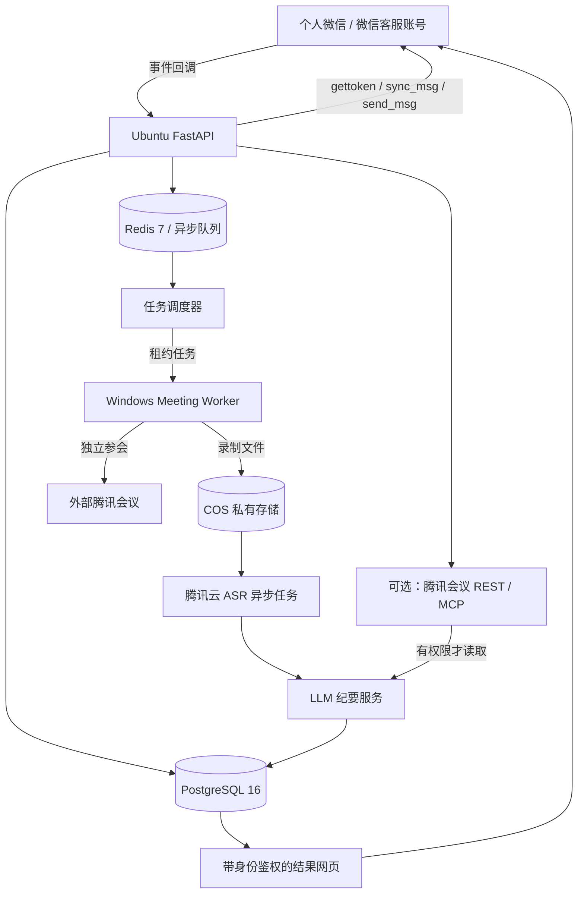

# AI 会议助手｜全链路开发方案 V1.0

**版本**：V1.0 技术方案 / 待验证架构  
**日期**：2026-10-09  
**目标**：普通微信用户提交外部腾讯会议邀请 → 会议助手尝试独立入会并在获得相应许可后录音 → 语音转写 → LLM 总结 → 微信/安全网页交付。  
**约束**：第一版仅腾讯会议；本地开发主环境 Windows 11 + WSL Ubuntu；不用 CloudBase；微信客服认证目前在等待处理；不能假设具有外部会议的创建者/主持人权限。

> **结论和阻断点**：腾讯会议 REST API/MCP 能读取**有权限**的会议、已有云录制、转写和纪要，却没有公开的一步式“加入任意外部会议并提供音频流”服务端能力。**独立参会+录音 Worker 是核心待验证依赖**。技术方案不等于已实现：在通过真实外部会议入会、采音和合法商用验证之前，不应宣称自动代理参会已完成。[T1][T2][T3][T4]

## 1. MVP 需求与验收

### 用户故事

1. 微信用户进入「AI会议助手」微信客服会话，发送一条腾讯会议链接、会议号/密码和时间。
2. 后端解析出必要字段；缺时间、密码或许可时询问/引导补充。用户确认任务和录音授权后才排期。
3. 到时将任务分配给可用参会 Worker。Worker 作为可识别的「AI会议记录助手」申请加入，默认禁用麦克风/摄像头，遵守主持人准入与录制规则。
4. 成功入会且完成录音许可确认后，记录声音、检测有效音频、分段存盘并上传；失败/被拒/超时有明确信息。
5. 会议结束后 ASR 形成带时间戳的逐字稿，LLM 输出摘要、决策和待办事项。用户通过微信查看可用结果或访问安全网页。

### 严格边界

- 不要求机器人代表用户发言、代替本人投票或操控主持人。
- **外部会议**指可以由别人创建；**不保证**进入加密、锁定、仅限特定成员或主持人拒绝的会议。
- **用户发送会议号不等于取得录音同意**：需用户确认其有权委托，机器人在会议中以可识别身份出现，并按会议/参会者适用规则告知和取得许可；未获许可不得开始录制。
- V1 单 Worker 单会议并发，人工测试期仅用授权的测试会议。

### 功能分层

| 层级 | V1 必须 | 条件成立才做 / 未来再做 |
|---|---|---|
| 消息入口 | 微信客服收发、任务确认 | 其他聊天平台 |
| 会议任务 | 解析、持久化、调度、取消、失败反馈 | 日历同步、多人共享 |
| 参会 | 外部会议入会、状态识别、音频采集 | SDK 商业多实例、实时字幕互动 |
| 后处理 | 自有录音 → ASR → 纪要 | 有权限时复用官方逐字稿或智能纪要 |
| 官方集成 | 可配置的 REST API / MCP Adapter | 腾讯会议 OAuth 多账号授权商业化 |
| 交付 | 微信消息及登录/绑定的查询页面 | 无限主动微信通知（受接口限制） |

## 2. 当前官方能力评估（文档确认 ≠ 实测）

| 能力 | 官方方式 | 能否覆盖“陌生外部会议” | V1 用法 | 证据 |
|---|---|---|---|---|
| 会议查询 | REST `GET /v1/meetings/{meetingId}`、按 `meeting_code` 查询；MCP `get_meeting_by_code` | **不能保证**。REST/MCP 都受调用账号及授权范围限制 | 辅助校验，失败不得作为会议不存在的证明 | [T1][T2] |
| 查已有云录制 | REST 录制列表/文件地址；MCP `get_records_list`、`get_record_addresses` | 需要录制访问权限；不是录音指令 | 可选信息源 | [T1][T5] |
| 查转写和智能纪要 | REST `/v1/records/transcripts/details`、`/v1/smart/minutes/{record_file_id}`；MCP 相应工具 | 限权限、账号版本和生成状态 | 获授权时复用 | [T1][T6][T7] |
| 实时转写推送 | `POST /v1/asr/push-status` + `meeting.asr-push` Webhook | **不能**凭任意外部会议号开启：创建者/企业资源范围要求 | 未来授权会议优化路径 | [T8][T9] |
| 开启实时转写 | `PUT /v1/real-control/meetings/{meeting_id}/asr` | 要求会议进行中且操作者为主持人 | V1 不作为外部会议依赖 | [T10] |
| 程序化入会 | 腾讯会议客户端 SDK `joinMeetingByJSON` 等 | **技术可发起**，但 SDK 接入需要企业版、授权范围与录音能力待 PoC | 优先申请官方 SDK | [T3] |
| 自动原始音频采集 | 公开 REST/MCP 未见该能力；SDK 原始音频接口未确认 | 不可直接承诺 | Windows Worker 录音 PoC / 咨询 SDK | [T1][T3] |
| 腾讯会议 MCP | 云端 Server + 本地 Python Skill 代理，18 个工具 | Token 与账号绑定，不能越过资源权限 | 开发期功能探测；生产非必需 | [T2] |

**特别注意 2026 年安全变更**：对新建腾讯会议**自建 OpenAPI 应用**，单个录制详情和录制转写详情等敏感接口需额外携带 **STS-Token**，经官方生成并通过 Webhook 获取；仅提供 SecretID/SecretKey 不够。[T5][T6][T11]

### MCP 的确切定位

腾讯会议官方公开的 18 个工具：
- 会议管理：`schedule_meeting`、`update_meeting`、`cancel_meeting`、`get_meeting`、`get_meeting_by_code`。
- 人员信息：`get_meeting_participants`、`get_meeting_invitees`、`get_waiting_room`、`get_user_meetings`、`get_user_ended_meetings`。
- 录制/文字：`get_records_list`、`get_record_addresses`、`get_transcripts_paragraphs`、`get_transcripts_details`、`search_transcripts`、`get_smart_minutes`。
- 辅助：`convert_timestamp`、`check_skill_version`。[T2]

没有官方列出的 `join_meeting` / `start_recording`。**个人 MCP Token 绝对不能当成所有微信客户共享的腾讯会议授权**，也不应向用户索要 Token 放进聊天记录。当前官方 Skill 的企业账号接入仍有申请/灰度限制。[T2]

## 3. 与企业微信自建应用的适配关系

### 对普通微信用户，实际入口为「微信客服」

- 普通个人微信用户不是公司企业微信内部成员，不能直接像私聊机器人一样给自建应用发消息。
- 在企业微信管理后台开通「微信客服」，创建「AI 会议助手」客服账号，并指定由 API 管理的客服账号/授权应用。
- 截图中的现有**企业微信自建应用**可在后台授权关系允许时作为**内部权限承载/配置入口**，不是直接面向普通个人微信用户的聊天窗口。
- 微信客服 Secret、企业微信自建应用 Secret、腾讯会议 OpenAPI 凭据是**独立密钥类型**；以当前后台页面明确指明的 Secret 来源和开放权限为准，不能混用。
- 开启微信客服 API 后，相关会话接待与回复模式可能切到 API 管理，需安排接待/人工兜底。[W1][W2][W3]

### 实际微信收发链路

```text
普通微信用户 --发邀请--> 微信客服账号(open_kfid)
                            |
                            v
             POST /webhooks/wecom/kf  (签名校验 + AES 解密)
                            |
                            v
        收到事件 kf_msg_or_event (事件中有 Token、OpenKfId)
                            |
                            v
             POST qyapi.weixin.qq.com/cgi-bin/kf/sync_msg
                            |
                     消息、msgid、external_userid
                            |
                消息去重 → 解析 → 创建/更新任务
                            |
             POST qyapi.weixin.qq.com/cgi-bin/kf/send_msg
                            |
                     微信客服给用户回复
```

回调通常**不是用户消息正文**，而是通知后端再去 `kf/sync_msg` 拉取；必须持久化 `next_cursor`，循环处理 `has_more`，并按 `(open_kfid,msgid)` 去重。官方接口镜像说明读取消息仅覆盖最近三天，不能长期停机后才回补。[W4]

微信客服普通文本回复受**用户最近主动发消息后 48 小时、最多 5 条**的窗口限制，还受会话接待状态约束。需要立刻回复「已接收任务」；数天后的纪要不能承诺自动主动发回，提供用户主动查询指令/安全网页。[W3]

### 企业微信后台配置顺序（认证通过后）

1. 微信客服开通、客服账号创建、取 `open_kfid`；核对已有自建应用是否已被授权管理该客服账号。
2. FastAPI 先部署对外可达的 HTTPS 回调：`https://api.example.com/webhooks/wecom/kf`。
3. 后台填回调 URL、Token、EncodingAESKey，完成 GET URL 校验；POST 回调也必须验签、解密。
4. 按后台所采用的「微信客服 API / 已授权自建应用」模式取对应 Secret；通过 `/cgi-bin/gettoken` 获取并缓存 access_token。
5. 个人微信打开客服链接测试：从控制台观测回调、`sync_msg`、`send_msg`，确认是真实普通微信用户而非企业内部成员。

## 4. 端到端系统设计



**责任分离**：FastAPI 负责业务；PostgreSQL 为任务状态的权威数据源；Redis 用来异步处理/调度；Windows Worker 独立负责参会与音频设备；COS 存放私有音频文件；ASR/LLM 不与会议客户端耦合。

### 路线选择器（避免把官方 API 用错）

1. 主路径 **A：独立参会**。外部会议无云录制权限 → Worker 参会录音 → COS → ASR → LLM。
2. 条件路径 **B：官方现有数据**。若授权范围内确实可取到逐字稿/录制 → 通过 REST（可选 MCP）读取 → LLM；不得跨权限读取。V1 对外部会议仍以 A 为可靠性目标。
3. 条件路径 **C：企业受控会议实时转写**。会议创建者/主持人已满足条件 → 开启官方实时转写+推送 → Webhook → LLM。**不是 A 的替代品**。[T8][T10]

## 5. FastAPI 路由与接口契约（我们自己定义的接口）

| 路由 | 方法 | 调用方 | 意义 |
|---|---|---|---|
| `/healthz` | GET | 监控 | 服务存活 |
| `/webhooks/wecom/kf` | GET/POST | 微信客服 | 回调 URL 验证/通知接收 |
| `/webhooks/tencent-meeting` | GET/POST | 腾讯会议 | 官方资源事件（**可选**，独立验签/解密） |
| `/v1/meetings/tasks` | POST | 内部服务或鉴权前端 | 创建/确认任务 |
| `/v1/meetings/tasks/{id}` | GET | 任务所有者 | 状态、失败原因 |
| `/v1/meetings/tasks/{id}/cancel` | POST | 任务所有者 | 取消、让 Worker 退出 |
| `/v1/meetings/tasks/{id}/result` | GET | 任务所有者 | 会议纪要、逐字稿摘要 |
| `/v1/workers/lease` | POST | Windows Worker（服务端鉴权） | 领取租约，不重复消费 |
| `/v1/workers/{id}/heartbeat` | POST | Windows Worker | 心跳、租约续期 |
| `/v1/workers/tasks/{id}/events` | POST | Windows Worker | 入会、等候室、录音、异常状态 |
| `/v1/workers/tasks/{id}/upload-url` | POST | Windows Worker | 获取限定对象名与时效的上传凭证 |

**示意：创建任务**（这是我们自定义的业务 API，不是腾讯会议官方 API）：

```http
POST /v1/meetings/tasks
Authorization: Bearer <your-service-or-user-token>
Idempotency-Key: 9b4b...unique...
Content-Type: application/json

{
  "meeting_code": "123456789",
  "meeting_password": "****",
  "scheduled_at": "2026-10-10T15:00:00+08:00",
  "planned_end_at": "2026-10-10T16:00:00+08:00",
  "requester_confirmed_authority": true
}
```

返回 `201 {"task_id":"...", "status":"AWAITING_CONSENT"}` 或在必要的许可确认后 `SCHEDULED`。`requester_confirmed_authority` **不是自动开录的最终许可**；实际需符合会议准入和参会者录制告知/许可流程。会议密码不应写到明文日志。

**状态机**：

`AWAITING_DETAILS → AWAITING_CONSENT → SCHEDULED → DISPATCHING → JOINING → (WAITING_ROOM) → IN_MEETING → RECORDING → UPLOADING → TRANSCRIBING → SUMMARIZING → COMPLETED`

任意合适状态可以进入 `FAILED` / `CANCELED`。`IN_MEETING` 不等于 `RECORDING`，`RECORDING` 不等于已获得有效非空音频。

### 任务一致性与重试

- 客服回调只做验签、持久化、入队，**立即响应**；不在回调请求内开会议或请求 LLM。
- 原始消息 `(open_kfid,msgid)` 唯一约束；创建任务使用 idempotency key；回调重放不会重复派遣参会机器人。
- PostgreSQL `SELECT ... FOR UPDATE SKIP LOCKED` 可用于抢占待调度行；每个 Worker 使用 lease、心跳和唯一 attempt_no 防双派遣。
- 网络失败、排队拒绝、主持人拒绝、录音被禁、音频文件为空均需要独立错误码；重试不应绕过主持人禁止入会的决定。
- 结果推送使用 `outgoing_messages` outbox，断网可补发；超出微信客服回复窗口应标记 `DEFERRED`，允许用户主动查询。

## 6. 数据模型与 SQL

配套 [`schema.sql`](./schema.sql) 可在 PostgreSQL 16 测试库初始化。核心表：

| 表 | 主键/关键列 | 职责 |
|---|---|---|
| `kf_users` | `corp_id, external_userid` 唯一 | 微信客服用户映射 |
| `kf_inbox` | `open_kfid, msg_id` 唯一 | 收到的消息、幂等 |
| `kf_sync_state` | `open_kfid, next_cursor` | 微信消息同步游标 |
| `meeting_tasks` | `id`, `user_id`, `status`, `scheduled_at` | 会议任务和授权状态 |
| `worker_nodes` / `task_attempts` | worker、lease、attempt | Worker 容量/心跳/重试 |
| `audio_assets` | `task_id`, `object_key`, `sha256` | COS 对象元数据 |
| `transcripts` | `task_id`, `source`, `body` | 标准化的逐字稿 JSON |
| `meeting_minutes` | `task_id`, `summary`, `action_items` | AI 纪要 |
| `task_events` / `callback_events` | trace / 事件 ID | 排障审计、回调幂等 |
| `outgoing_messages` | `user_id`, `status` | 消息可靠投递 |

**建议**：会议链接、密码应用层加密后存储；尽量只在参与入会的阶段解密。访问令牌/SDK Secret 放环境密钥系统，不作为普通数据库字段。

## 7. 外部 API 的确切调用方法

### 7.1 微信客服 API：普通个人微信消息

**基础域名** `https://qyapi.weixin.qq.com`，具体客服权限和 Secret 以后台授权配置为准。

1. 获取并缓存 token：

```http
GET /cgi-bin/gettoken?corpid=CORP_ID&corpsecret=KF_APPROVED_SECRET
```

缓存 `access_token` 和 `expires_in`；`expires_in` 通常为 7200 秒，提前留安全余量，遇 token 失效刷新一次。[W5]

2. 收到验证过并解密的 `kf_msg_or_event` 事件，提取 `Token` 和 `OpenKfId`，读取消息：

```http
POST /cgi-bin/kf/sync_msg?access_token=ACCESS_TOKEN
Content-Type: application/json

{
  "cursor": "PREVIOUS_NEXT_CURSOR",
  "token": "CALLBACK_TOKEN_FOR_SYNC",
  "limit": 1000,
  "open_kfid": "OPEN_KFID"
}
```

保存 `next_cursor`，按 `has_more` 翻页，处理 `msg_list` 中的 `msgid`、`external_userid`、`msgtype`、`text.content`；并非每条都是用户文本，过滤 `origin` 和类型。[W4]

3. 回复微信客户：

```http
POST /cgi-bin/kf/send_msg?access_token=ACCESS_TOKEN
Content-Type: application/json

{
  "touser": "EXTERNAL_USERID",
  "open_kfid": "OPEN_KFID",
  "msgtype": "text",
  "text": {"content": "收到会议邀请，请确认时间和录音授权。"}
}
```

`kf/send_msg` 有会话状态、48h/5条限制。对于结果查询页面采用鉴权而非裸露 COS URL。[W3]

### 7.2 腾讯会议 REST OpenAPI：在账号授权范围内调用

**基础域名** `https://api.meeting.qq.com/v1`。

- 自建腾讯会议应用：**AK/SK** 鉴权，内部企业资源管理；签名放 `X-TC-Signature`，涉及 nonce/timestamp 和 HMAC-SHA256，推荐使用官方 Python SDK 封装，避免手搓签名。不是企业微信的自建应用。[T12]
- 第三方腾讯会议应用：**OAuth 2.0**，用户授权产生 `auth_code` → `access_token` → 刷新；向普通个人开放服务时比企业 AK/SK 更适合，但实际 API 仍受账号和会议范围限制。[T13]
- 仅查到外部会议号时，`GET /v1/meetings?meeting_code=...` **可能返回无权限**，不能阻止用户提交已经合法邀请的会议任务。[T14]

Python OpenAPI SDK（**服务端 REST SDK，不负责加入会议**）：

```bash
pip install --upgrade wemeet-openapi-sdk-python
```

正式业务适配器建议先提供 `get_meeting_if_authorized()`、`get_recording_if_authorized()`、`get_transcript_if_authorized()` 和 `get_minutes_if_authorized()` 四个封装方法，并在日志中区分无权限/未生成/不存在/网络异常。[T15]

按需调用（请求需各自鉴权、operator 参数，部分还需 STS）：

```text
GET /v1/meetings?meeting_code=...              # 有权限才会成功
GET /v1/records                              # 授权录制列表（以该接口具体参数为准）
GET /v1/addresses/{record_file_id}            # 单个录制详情，注意 STS
GET /v1/records/transcripts/details           # 转写详情，注意 STS
GET /v1/smart/minutes/{record_file_id}        # 智能纪要（需支持账号/功能）
POST /v1/asr/push-status                      # 会议创建者/授权范围才可开启推送
```

> 不要把这些 URL 当作无需签名、无需 `operator_id` 的可直接访问链接；完整参数/权限以各 API 单页文档为准。[T5][T6][T7][T8]

### 7.3 MCP：怎么接入，而不是误用

官方架构是云端 `mcp.meeting.tencent.com` + Skill 内的 Python 代理（JSON-RPC，令牌放在 `X-Tencent-Meeting-Token` 中），现阶段官方文档按个人 Token/Skill 模式描述，企业账号灰度申请。[T2]

**开发期**：在隔离测试账号的 Claude Code/受信任 MCP 客户端安装官方 Skill，验证 `get_user_meetings`、`get_records_list`、`get_smart_minutes`；不要暴露 Token。

**业务期**：若官方许可其用于正式服务，再用 Python MCP Client/封装代理，只向 `MeetingDataProvider` 暴露已授权的数据能力。用户提交会议任务**不依赖** MCP 可用。企业面向多用户服务优先研究腾讯会议第三方 OAuth 接入，不要共享公司个人 MCP Token。

### 7.4 腾讯会议 Webhook（受权资源的事件）

另设 `/webhooks/tencent-meeting`，与微信客服回调**完全分离**。按官方文档校验腾讯会议签名、base64/解密包、去重 `trace_id`；配置验证 GET 和业务事件 POST 的协议不同，成功 POST 的官方要求响应正文是精确字符串 `successfully received callback`，不要错误地返回普通 JSON `{"ok":true}`。[T16]

可订阅：`recording.completed`（云录制转码完成）、`meeting.asr-push`（实时转写推送）；只有应用有权限的资源才会产生有效可用数据。[T8][T9][T17]

### 7.5 COS、ASR、LLM

- **音频**：Windows Worker 本地先分段存 WAV/PCM；用 FFmpeg 统一格式并压缩为 ASR 支持格式；校验非空、duration、sha256。经短时受限上传凭证上传 COS 私有桶。COS Python SDK 支持小文件上传及分块上传。[C1]
- **ASR**：后端异步提交腾讯云**录音文件识别**任务，完成后读取文本及时间戳；接口本身为异步而非立刻返回完整结果。配置重试和预算上限。[C2]
- **LLM**：输入标准化分段 `[start_ms, end_ms, speaker?, text]`；使用结构化输出 `summary / decisions / action_items / risks / evidence_segments`。没有说话人/负责人证据时明确标注“未知”，不编造。
- **来源优先级**：官方转写（**有合法授权、确实可访问时**） > Worker 自录音频 → ASR；两者来源记录在 `transcripts.source`，不混淆。

## 8. Windows Worker：核心 PoC 与生产边界

### PoC 阶段

1. 验证 Tencent Meeting SDK 接入资格：SDK 企业版许可、能否从机器人服务账号加入他人创建的会议、是否有原始 PCM/混音回调、是否支持无人值守和多实例；在取得许可前不假定可用。[T3]
2. 若 SDK 不可用，保留现有 Windows 11 版客户端 + PyAutoGUI/UIA/视觉匹配 + WASAPI Loopback 的实验；已经实测基本键鼠模拟可输入会议号，但尚未验证无人值守入会、会议音频完整性、权限以及 24h 稳定性。
3. 测试会议由同意录制的参与者发起，录音开始前明确身份和许可，主办方拒绝即退出/标记失败。

### Worker 与后端通信协议（自主设计）

- Worker 经受保护的 `/v1/workers/lease` 拉取任务，服务端保证同一任务只有一个活跃租约；Worker 每 15～30 秒心跳。
- Worker 发事件 `JOIN_REQUESTED`、`IN_WAITING_ROOM`、`JOINED`、`RECORDING_STARTED`、`RECORDING_STOPPED`、`LEFT`、`AUDIO_UPLOADED` 或 `FAILED`。
- 以屏幕状态结合音频测量确定是否有效入会（仅 UIA 窗口存在绝不等于入会成功）。录音以固定段长落盘，先 fsync 后上传，断网后支持恢复上传。
- 停止条件：会议结束、主持人拒绝、最长录音时间、用户取消、录音许可被撤回；不得绕过锁定会议或主持人拒绝。
- V1 每 Worker 最大并发 1；后续多会议必须隔离音频设备/用户会话与资源竞争。

## 9. 本地开发与部署链路

### WSL Ubuntu（核心后端）

```bash
mkdir -p ~/projects/meeting-assistant
cd ~/projects/meeting-assistant
# 将本方案目录内 docker-compose.yml / .env.example / schema.sql 放入此目录
cp .env.example .env
# 编辑 .env，至少修改 POSTGRES_PASSWORD 与 DATABASE_URL 一致

docker compose up -d
# 建表（首次初始化用；正式应用之后应改用 Alembic 迁移）
docker compose exec -T postgres psql -U meeting -d meeting_assistant < schema.sql

python3 -m venv .venv
source .venv/bin/activate
pip install fastapi 'uvicorn[standard]' sqlalchemy asyncpg alembic pydantic-settings \
  httpx redis arq cryptography
# 后端项目代码完成后：
uvicorn app.main:app --reload --host 127.0.0.1 --port 8000
```

项目依赖路径与 `uvicorn app.main:app` 是计划的包名；**本方案交付的是架构/SQL/本地基础设施，不包含完整 `app.main` 实现**。先不要直接拿它当已完成服务。

建议目录：

```text
meeting-assistant/
├── backend/app/
│   ├── main.py
│   ├── api/           # kf callback, task CRUD, Worker API, result auth
│   ├── models/        # SQLAlchemy models / Alembic migrations
│   ├── integrations/  # wecom_kf, tmeeting_openapi, tmeeting_mcp, cos, asr, llm
│   ├── services/      # parser, scheduler, workflow, summary
│   └── security/      # crypt, tokens, webhook verification
├── worker_windows/   # meeting controller, recorder, watchdog
├── tests/
├── schema.sql
├── docker-compose.yml
└── .env.example
```

### Windows（单独运行）

- 使用 Windows 11 原生 Python 环境和腾讯会议客户端，不要在 WSL 里模拟 Windows 音频设备。
- Windows Worker 通过公网安全 API 或开发期内网连接到 FastAPI。生产时 Worker 仅允许向服务端发起连接，不必暴露公网入站端口。
- 不应让 Windows 的后台 Windows Service 处于无交互 Session 0 就假定 GUI 可工作；图形会话、锁屏、音频设备和重启恢复需要单独测试。

### 公网生产

- **WSL**：开发环境，不作为持续在线公网服务器。
- **Ubuntu 云主机**：运行 FastAPI（容器）、PostgreSQL/Redis（隔离网络、禁止公网直接暴露）、队列与 Nginx/Caddy HTTPS。
- **Windows 专用设备/虚拟桌面**：持续在线执行腾讯会议 Worker；用 VPN/mTLS 或强鉴权请求后端。
- **COS**：私有桶保存录音；服务端以授权检查后下发短时读取 URL。生产尽量用角色/临时凭据。
- **回调域名**：`https://api.example.com/webhooks/wecom/kf`、`https://api.example.com/webhooks/tencent-meeting`；不同 provider 不共享 Token/EncodingAESKey。

## 10. 安全、隐私、成本和运营

- **最小权限**：微信客服 Secret、腾讯会议 OAuth/AKSK、MCP Token、腾讯云 ASR/COS 密钥独立管理；不写进 Git、日志、URL query 和 LLM Prompt。
- **录音合法性**：会前告知委托者，入会后让参会方明确知晓机器人身份和录音目的；如果会议/主持人拒绝则不开始或立即停止录音；处理个人信息、会议内容和跨境传输时应按适用法规与公司制度审查。
- **数据最小化**：按需保存逐字稿；建议默认音频保留 30 天（**产品政策建议，不是官方规定**），支持立即删除，结果页面需要用户身份绑定、权限校验和访问日志。
- **敏感消息**：在客服同步后的内容存储前过滤/脱敏，会议链接和密码加密；避免在异常堆栈中打印原始消息。
- **费用**：云服务器、Windows 参会设备、COS 存储/流量、ASR 分钟费、LLM Token 成本；按实际云产品报价估算，没有权限定价不得假设免费。
- **服务品质**：目标指标是 `入会成功率`、`有效音频覆盖率`、`转写可读率`、`纪要交付率`，按用户触发条件区别统计，不宣称 100%。

## 11. 开发顺序、门槛与验收

| 阶段 | 开发内容 | 验收标准 | 是否依赖认证 |
|---|---|---|---|
| G0 环境 | WSL postgres/redis、SQL、FastAPI skeleton、基础健康检查 | 启动后可查询库、测试数据库事务 | 否 |
| G1 核心可行性 | Windows 外部会议入会/录音 PoC + SDK 官方咨询 | 授权测试会议实际入会，10 分钟连续可听人声、无空音轨，有失败反馈 | 否 |
| G2 任务链 | Parser + Tasks + scheduler + Worker lease / heartbeat | 模拟微信消息创建任务，重启不丢任务、不会双派遣 | 否 |
| G3 后处理 | COS 上传、ASR、结构化纪要、结果页 | 10～30 分钟录音出可追溯逐字稿和待办 | 否 |
| G4 官方集成 | REST/MCP 有权限会议测试、无权限回退 | 受权可读，外部无权限时走 Worker 而非报错死路 | 需腾讯会议账号/接口权限 |
| G5 微信客服 | 已认证后台、GET/POST 回调、sync_msg、send_msg | 个人微信发一条消息能收到任务确认且不重复 | **是** |
| G6 E2E | 多种外部会议，演练等候室、拒绝、掉线、长会 | 全链路演示与失败清单、权限与删除验证 | 是 |

**决策门槛**：若 G1 无法证明实际外部会议合法、稳定入会并录音，则停止宣称“自动参会”V1 可上线，改为有限 Beta 或仅处理已提供的录音文件。不能靠把 REST/MCP 接通来掩盖这个缺口。

## 12. 下一周可直接执行的任务拆分

- **第 1 天**：建立代码仓、迁移和测试库；用 Mock 微信客服事件生成 `meeting_task`；整理录音授权交互。
- **第 2～3 天**：实测 Windows 录音（WASAPI、长时稳定）、入会状态；同步向腾讯会议官方询问客户端 SDK 凭据、音频流许可与服务账号并发。
- **第 3～4 天**：实现租约调度、心跳、失败码、COS 上传、转写与 LLM 后处理。
- **第 5 天**：集成测试、外部会议异常矩阵；认证通过则微信客服联调。

以上是建议节奏，不含外部资质审批和 SDK 商业授权等待时间，不对尚无接口许可的功能做固定交付承诺。

## 13. 官方与接口参考资料（按功能归类）

**腾讯会议官方**

- [T1] REST API 概览：https://cloud.tencent.com/document/product/1095/113415
- [T2] 腾讯会议 MCP 说明（18 工具、云端 Skill/Token、企业账号灰度）：https://meeting.tencent.com/support/topic/2233/index.html
- [T3] 客户端 SDK 简介（企业版与平台要求）：https://cloud.tencent.com/document/product/1095/58217
- [T4] 应用类型说明（自建 AK/SK vs 三方 OAuth）：https://cloud.tencent.com/document/product/1095/84320
- [T5] 查询单个录制详情及 STS 要求：https://cloud.tencent.com/document/product/1095/51180
- [T6] 查询录制转写详情及 STS 要求：https://cloud.tencent.com/document/product/1095/65111
- [T7] 智能纪要接口：https://cloud.tencent.com/document/product/1095/109458
- [T8] 开启实时转写推送（资源范围限制）：https://cloud.tencent.com/document/product/1095/107522
- [T9] `meeting.asr-push` Webhook：https://cloud.tencent.com/document/product/1095/107523
- [T10] 开启实时转写（主持人）：https://cloud.tencent.com/document/product/1095/106034
- [T11] STS Token 生成：https://cloud.tencent.com/document/product/1095/127650
- [T12] AK/SK 认证：https://cloud.tencent.com/document/product/1095/42413
- [T13] 第三方应用 OAuth 认证：https://cloud.tencent.com/document/product/1095/51257
- [T14] 查询会议访问范围：https://cloud.tencent.com/document/product/1095/93432
- [T15] 官方 Python REST SDK：https://github.com/TencentCloud/wemeet-openapi-sdk-python
- [T16] Webhook 回调服务要求：https://cloud.tencent.com/document/product/1095/51608
- [T17] 云录制已完成事件：https://cloud.tencent.com/document/product/1095/53230

**企业微信接口说明**（官网接口有时不易直接抓取；以下是企业微信 API 文档镜像，应与当前后台/官方页面复核）

- [W1] 微信客服 API 概述及开通：https://qiyeweixin.apifox.cn/doc-417793
- [W2] 回调配置：https://qiyeweixin.apifox.cn/doc-417771
- [W3] `kf/send_msg` 与客服发送窗口：https://qiyeweixin.apifox.cn/api-10061328
- [W4] `kf/sync_msg`、事件通知与游标：https://qiyeweixin.apifox.cn/api-10061327
- [W5] `gettoken`：https://qiyeweixin.apifox.cn/api-10061194

**腾讯云后处理**

- [C1] COS Python SDK 上传：https://cloud.tencent.com/document/product/436/65820
- [C2] 录音文件识别 API：https://cloud.tencent.com/document/product/1093/37823

---

**当前真实状态（截至方案编写）**：微信客服企业认证待处理；此前 Windows UIA 只检测到部分顶层控件，PyAutoGUI 已能输入会议号，尚无真实全自动外部参会成功证据；腾讯会议官方 REST/MCP 未使用实际凭据联调，SDK 商业接入及音频能力未取得官方确认。V1 是**可执行的设计与验收计划**，不是交付完毕的产品。
